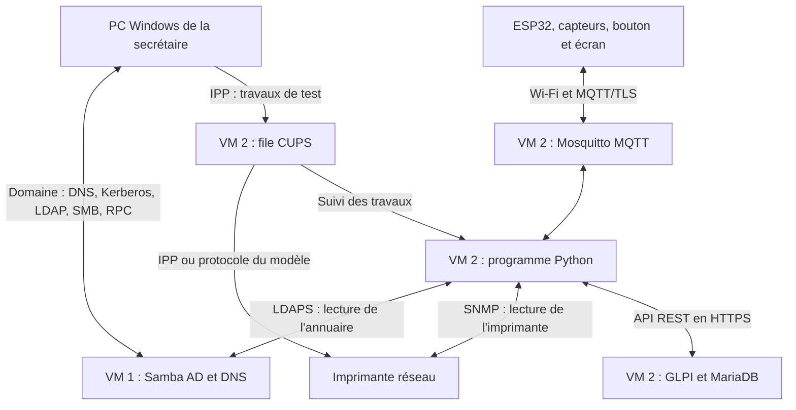

# Guide technique de mise en place du projet de Wassim

Date : 22 novembre 2026.

Ce guide explique comment construire la maquette du « service informatique augmenté », depuis les premières machines virtuelles jusqu'au ticket GLPI. Il suit cet ordre : **VM 1 Samba AD → PC de la secrétaire → VM 2 diagnostic et GLPI → imprimante → ESP32 → essais de bout en bout**.

Les commandes sont des instructions à exécuter sur les machines indiquées. Elles n'ont pas été exécutées sur une maquette matérielle lors de la rédaction. Les adresses, noms et comptes ci-dessous sont des choix pour le laboratoire ; les remplacer ensemble si le réseau du lycée impose un autre plan. Le modèle exact d'imprimante et les références des modules ESP32 restent à relever avant le câblage.

Le besoin métier reste une amélioration proposée à faire valider par le tuteur. Les essais utilisent des données fictives, au lycée ; cette organisation est à faire valider par l'académie conformément au cadre du projet E6.

## Sommaire

1. [Comprendre les rôles et les échanges](#1-comprendre-les-rôles-et-les-échanges)
2. [Préparer les machines et le réseau](#2-préparer-les-machines-et-le-réseau)
3. [Installer Samba sur la VM 1](#3-installer-samba-sur-la-vm-1)
4. [Préparer les certificats de la maquette](#4-préparer-les-certificats-de-la-maquette)
5. [Joindre le PC de la secrétaire au domaine](#5-joindre-le-pc-de-la-secrétaire-au-domaine)
6. [Préparer la VM 2 et sa consultation de Samba](#6-préparer-la-vm-2-et-sa-consultation-de-samba)
7. [Installer GLPI sur la VM 2](#7-installer-glpi-sur-la-vm-2)
8. [Configurer la surveillance SNMP de l'imprimante](#8-configurer-la-surveillance-snmp-de-limprimante)
9. [Installer MQTT sur la VM 2](#9-installer-mqtt-sur-la-vm-2)
10. [Configurer et raccorder le boîtier ESP32](#10-configurer-et-raccorder-le-boîtier-esp32)
11. [Construire le programme Python de diagnostic](#11-construire-le-programme-python-de-diagnostic)
12. [Connaître les travaux envoyés et la file Windows](#12-connaître-les-travaux-envoyés-et-la-file-windows)
13. [Régler les accès réseau](#13-régler-les-accès-réseau)
14. [Réaliser la recette progressive](#14-réaliser-la-recette-progressive)
15. [Dépanner et sauvegarder](#15-dépanner-et-sauvegarder)
16. [Préparer les ajouts V2](#16-préparer-les-ajouts-v2)
17. [Consulter les références](#17-consulter-les-références)

## 1. Comprendre les rôles et les échanges

### 1.1 Ce que chaque élément fait

| Élément | Fonction dans la maquette |
|---|---|
| VM 1, Ubuntu et Samba AD | Domaine, annuaire des utilisateurs et des PC, DNS du domaine |
| PC Windows de la secrétaire | Poste membre du domaine ; envoie des travaux d'impression fictifs |
| VM 2, Ubuntu | Programme Python, service MQTT, serveur web, GLPI, base MariaDB ; CUPS si les impressions passent par elle |
| Imprimante réseau | Imprime ; fournit ses informations par SNMP |
| ESP32 fixé à l'imprimante | Lit les capteurs et les entrées ; transmet les événements ; commande l'affichage |
| GLPI | Enregistre les équipements, les tickets et leur suivi |

GLPI est une application web sur la VM 2. Il ne s'agit pas d'une troisième VM. Python dialogue avec son API, même si les deux programmes sont sur le même Ubuntu.

L'imprimante **ne rejoint pas le domaine Samba**. Le boîtier **ne dialogue pas directement avec GLPI**. La fixation du boîtier sur l'imprimante permet de mesurer les vibrations ; ce n'est pas une liaison informatique.

### 1.2 Schéma des communications



### 1.3 Langage, protocole et support réseau

| Terme | Ce que c'est | Utilisation ici |
|---|---|---|
| Python | Langage de programmation | Diagnostic sur VM 2 |
| C/C++ | Langages de programmation | Firmware ESP32 avec ESP-IDF ou Arduino |
| Wi-Fi, Ethernet | Moyens de raccordement au réseau | ESP32 en Wi-Fi ; VM et imprimante accessibles sur le LAN |
| SNMP | Protocole de supervision | État et compteurs de l'imprimante |
| LDAP avec TLS, ici LDAPS | Accès sécurisé à un annuaire | Service du PC dans Samba AD |
| MQTT avec TLS | Échange de messages via un serveur intermédiaire | Mesures et événements du boîtier |
| HTTPS | HTTP chiffré et authentification du serveur | Interface et API GLPI |
| JSON | Format des messages | Événements ESP32 et corps des appels API |

**Choix de mise en œuvre de ce guide :** MQTT/TLS, Mosquitto, Apache, MariaDB et l'API historique GLPI. Ces choix rendent l'architecture concrète ; ils ne constituent pas des réalisations déjà validées. Le projet source fixe notamment SNMP, Samba, GLPI et le lien Wi-Fi, mais ne fixe pas tous ces détails.

### 1.4 Progression retenue

| Étape | Résultat utile |
|---|---|
| Socle | Un PC rejoint Samba, le DNS fonctionne, les machines ont la même heure |
| Première intégration | VM 2 lit l'imprimante et crée un ticket d'essai GLPI |
| Boîtier V1 | Vibration, bouton, écran et transmission MQTT |
| Diagnostic enrichi | Lecture du service dans Samba, file Windows, comparaison des témoins |
| V2 | Badge technicien, humidité, preuve de réparation, station des PC neufs |

On peut donc préparer Samba dès le départ sans rendre la première alerte d'imprimante dépendante de l'annuaire.

## 2. Préparer les machines et le réseau

### 2.1 Ressources proposées

| Machine | Système de référence | Ressources de départ proposées |
|---|---|---|
| VM 1 | Ubuntu Server 24.04 LTS | 2 vCPU, 2 à 4 Go de RAM, disque 25 Go |
| VM 2 | Ubuntu Server 24.04 LTS | 2 à 4 vCPU, 4 Go de RAM, disque 40 Go |
| PC secrétaire | Windows 11 Pro, Éducation ou Entreprise | Si VM : 2 vCPU, 4 Go de RAM minimum, disque 64 Go, TPM virtuel et démarrage compatibles Windows 11 |

Ces valeurs sont un point de départ à adapter au PC hôte. Windows 11 Famille ne rejoint pas un domaine AD. Le projet prévoit une VM Entreprise d'évaluation, ou une édition compatible déjà licenciée ; relever les conditions et la date d'expiration au téléchargement.

Créer les VM avec KVM/virt-manager ou l'hyperviseur déjà utilisé au lycée. Une VM Windows supplémentaire reste nécessaire si aucun PC compatible n'est disponible : « deux VM » désigne ici les deux serveurs Ubuntu.

### 2.2 Plan d'adressage d'exemple

| Équipement | Nom | Adresse |
|---|---|---|
| Routeur de laboratoire déjà configuré | passerelle | `192.168.50.1/24` |
| VM 1 | `dc1.wassim.internal` | `192.168.50.10/24` |
| VM 2 | `srv2.wassim.internal` | `192.168.50.20/24` |
| Imprimante | `imp-cardio.wassim.internal` | `192.168.50.30/24` |
| PC secrétaire | `PC-SECRETARIAT` | `192.168.50.40/24` |
| ESP32 | `boitier-cardio-01` | Réservation DHCP `192.168.50.50` |
| Interface web GLPI | `glpi.wassim.internal` | `192.168.50.20` |
| Service MQTT | `mqtt.wassim.internal` | `192.168.50.20` |

Le DNS des clients sera `192.168.50.10`. Le domaine DNS sera `wassim.internal`, le domaine court `WASSIM` et le royaume Kerberos `WASSIM.INTERNAL`.

Ce réseau de laboratoire doit être disponible. Ne pas attribuer ces adresses sur un réseau existant sans vérifier les doublons. Le routeur fournit, si nécessaire, le DHCP, l'accès Internet et une référence DNS/NTP autorisée. Samba n'installe pas automatiquement un serveur DHCP.

Si le laboratoire est totalement hors ligne, préparer les paquets et archives à l'avance et définir une référence horaire locale. La passerelle de l'exemple n'existe pas par défaut.

### 2.3 Raccorder correctement les VM

Les deux VM, le PC, l'imprimante et le point d'accès Wi-Fi doivent pouvoir échanger sur le réseau de laboratoire. Un **pont vers l'Ethernet du laboratoire** est une possibilité. Avec un réseau virtuel routé, les routes et les accès depuis les équipements physiques doivent être prévus.

Le NAT par défaut de certaines VM ne suffit pas : l'ESP32 ne peut généralement pas ouvrir une connexion vers un serveur caché derrière ce NAT. Un réseau « interne » entre VM n'inclut pas non plus l'imprimante physique. Avec un pont Wi-Fi, vérifier les limites du pilote et de l'hyperviseur ; un raccordement Ethernet de l'hôte est plus prévisible.

Sur le point d'accès : SSID dédié, sécurité WPA2/WPA3 selon la carte, bande compatible avec l'ESP32, DNS du domaine transmis par DHCP et absence d'isolation entre clients pour cette maquette.

### 2.4 Régler Ubuntu avant Samba

Sur chaque Ubuntu, relever l'interface :

```bash
ip -br address
ip route
resolvectl status
```

L'exemple utilise `enp1s0`. Remplacer ce nom par celui réellement affiché. À la console de la VM, modifier le fichier Netplan qui gère déjà cette interface ; ne pas ajouter une configuration contradictoire dans un second fichier.

Exemple **VM 1, avant installation de Samba**, avec `192.168.50.1` supposé fournir un DNS amont :

```yaml
network:
  version: 2
  renderer: networkd
  ethernets:
    enp1s0:
      dhcp4: false
      addresses: [192.168.50.10/24]
      routes:
        - to: default
          via: 192.168.50.1
      nameservers:
        addresses: [192.168.50.1]
```

Sur VM 2 : même structure, adresse `192.168.50.20/24`. Après mise en route de VM 1, remplacer son DNS par `192.168.50.10` et ajouter `search: [wassim.internal]` dans `nameservers`.

```bash
sudo netplan generate
sudo netplan try
```

Confirmer depuis la console si l'accès fonctionne. La syntaxe et l'application des configurations sont décrites dans la [documentation Netplan](https://netplan.readthedocs.io/en/stable/examples/).

Sur VM 1 :

```bash
sudo hostnamectl set-hostname dc1
```

Dans `/etc/hosts`, conserver `127.0.0.1 localhost` et associer le nom du contrôleur à son IP de laboratoire :

```text
192.168.50.10 dc1.wassim.internal dc1
```

Retirer l'ancienne association de `dc1` à `127.0.1.1` si elle existe. Sur VM 2, utiliser `srv2` et `192.168.50.20`.

Sur les deux VM :

```bash
sudo apt update
sudo apt upgrade
sudo apt install openssh-server chrony ca-certificates curl openssl
sudo timedatectl set-timezone Europe/Paris
hostname -f
chronyc tracking
```

**Validation :** IP et nom conformes, route correcte, accès aux dépôts, horloge synchronisée. Créer un instantané « Ubuntu prêt » avant le provisionnement de Samba.

## 3. Installer Samba sur la VM 1

### 3.1 Installer le rôle de contrôleur de domaine

Ces commandes concernent une **VM 1 neuve**, sans domaine ni partage à conserver :

```bash
sudo apt install samba-ad-dc krb5-user bind9-dnsutils smbclient
sudo systemctl disable --now smbd nmbd winbind
sudo systemctl mask smbd nmbd winbind
sudo systemctl unmask samba-ad-dc
sudo systemctl enable samba-ad-dc
```

Aux questions Kerberos pendant l'installation, les valeurs seront ensuite remplacées par le fichier généré par Samba.

Si `/etc/samba/smb.conf` existe, en conserver une copie sous un nom libre, par exemple :

```bash
sudo mv /etc/samba/smb.conf /etc/samba/smb.conf.avant-domaine
sudo samba-tool domain provision --interactive --use-rfc2307
```

Répondre :

| Question | Réponse |
|---|---|
| Realm | `WASSIM.INTERNAL` |
| Domain | `WASSIM` |
| Server Role | `dc` |
| DNS backend | `SAMBA_INTERNAL` |
| DNS forwarder | DNS amont réel, par exemple `192.168.50.1` |
| Administrator password | Mot de passe propre à la maquette, saisi à l'invite |

Ne pas relancer le provisionnement pour corriger une erreur mineure d'un domaine déjà créé. Revenir à l'instantané de la VM neuve si une reconstruction est nécessaire.

### 3.2 Terminer le DNS et Kerberos

Dans la section `[global]` de `/etc/samba/smb.conf`, vérifier que `dns forwarder` vise le DNS amont réel, pas `127.0.0.53` ni l'adresse du contrôleur lui-même.

Sauvegarder la configuration de résolution existante. Sur cette VM dédiée, faire utiliser directement le DNS Samba selon la procédure Ubuntu : désactiver `systemd-resolved`, remplacer le lien `/etc/resolv.conf` par un fichier contenant :

```text
nameserver 127.0.0.1
search wassim.internal
```

Commandes, depuis la console :

```bash
sudo cp -L /etc/resolv.conf /root/resolv.conf.avant-samba
sudo systemctl disable --now systemd-resolved
```

Vérifier avec `ls -l /etc/resolv.conf` s'il s'agit d'un lien ; si oui, le supprimer avec `sudo unlink /etc/resolv.conf`, puis créer le fichier ci-dessus avec `sudo nano /etc/resolv.conf`. Si c'est déjà un fichier ordinaire, le modifier directement.

```bash
sudo cp /var/lib/samba/private/krb5.conf /etc/krb5.conf
sudo testparm -s
sudo systemctl start samba-ad-dc
sudo systemctl status samba-ad-dc --no-pager
```

Ce chemin suit le [provisionnement officiel Ubuntu de Samba AD](https://ubuntu.com/server/docs/how-to/samba/provision-samba-ad-controller/). Ne pas installer BIND en parallèle : l'exemple utilise le DNS interne de Samba.

### 3.3 Vérifier avant de continuer

```bash
dig @127.0.0.1 dc1.wassim.internal A +short
dig @127.0.0.1 _ldap._tcp.wassim.internal SRV +short
dig @127.0.0.1 _kerberos._tcp.wassim.internal SRV +short
kinit Administrator@WASSIM.INTERNAL
klist
sudo samba-tool dbcheck --cross-ncs
```

Attendu : IP `.10`, enregistrements de service vers `dc1`, ticket Kerberos obtenu, base cohérente. Ne pas afficher les mots de passe ou clés dans le compte rendu.

### 3.4 Créer les services et les comptes fictifs

Sur VM 1 :

```bash
sudo samba-tool ou create 'OU=Cardiologie,DC=wassim,DC=internal'
sudo samba-tool ou create 'OU=Radiologie,DC=wassim,DC=internal'
sudo samba-tool ou create 'OU=ComptesTechniques,DC=wassim,DC=internal'
sudo samba-tool user create secretaire.cardio --userou='OU=Cardiologie'
sudo samba-tool user create svc-diagnostic --userou='OU=ComptesTechniques'
```

Les mots de passe sont demandés à l'invite. `svc-diagnostic` reste un utilisateur ordinaire, sans ajout aux groupes d'administration. Il servira à lire les attributs autorisés de l'annuaire. Vérifier les droits effectifs avec le test LDAP de la section 6 et prévoir le renouvellement de son mot de passe.

Créer les noms des services de VM 2 dans le DNS :

```bash
sudo samba-tool dns add dc1.wassim.internal wassim.internal srv2 A 192.168.50.20 -U Administrator
sudo samba-tool dns add dc1.wassim.internal wassim.internal glpi A 192.168.50.20 -U Administrator
sudo samba-tool dns add dc1.wassim.internal wassim.internal mqtt A 192.168.50.20 -U Administrator
sudo samba-tool dns add dc1.wassim.internal wassim.internal imp-cardio A 192.168.50.30 -U Administrator
```

Si une entrée existe déjà, la lire et la vérifier plutôt que l'ajouter une deuxième fois. Les commandes d'administration sont détaillées dans le [manuel samba-tool](https://www.samba.org/samba/docs/current/man-html/samba-tool.8.html).

### 3.5 Fournir l'heure au domaine

Samba ne remplace pas le service NTP. Sur VM 1, conserver une source horaire amont autorisée dans `/etc/chrony/chrony.conf`. Pour le laboratoire, y ajouter :

```text
allow 192.168.50.0/24
ntpsigndsocket /var/lib/samba/ntp_signd
```

Sur Ubuntu, vérifier l'utilisateur du service Chrony, généralement `_chrony`, puis lui donner accès au socket de signature Samba :

```bash
sudo chgrp _chrony /var/lib/samba/ntp_signd
sudo chmod 750 /var/lib/samba/ntp_signd
sudo systemctl restart chrony
chronyc sources -v
chronyc tracking
```

Sur VM 2, remplacer les sources concurrentes par `server dc1.wassim.internal iburst` si VM 1 est la référence choisie, puis redémarrer Chrony. Confirmer la synchronisation après redémarrage des VM. La directive de signature est documentée dans le [manuel Chrony](https://chrony-project.org/doc/latest/chrony.conf.html).

**Validation de VM 1 :** DNS, Kerberos, comptes, unités d'organisation et heure fonctionnent. Conserver un instantané « Domaine créé ».

## 4. Préparer les certificats de la maquette

### 4.1 Ce qu'il faut obtenir

HTTPS, MQTT/TLS et LDAPS doivent pouvoir vérifier le serveur auquel ils parlent. Préparer une autorité de certification (CA) de laboratoire, puis deux certificats serveur :

| Certificat | Noms DNS à inscrire dans le SAN |
|---|---|
| VM 1 | `dc1.wassim.internal` |
| VM 2 | `srv2.wassim.internal`, `glpi.wassim.internal`, `mqtt.wassim.internal` |

Utiliser l'autorité interne du laboratoire si elle existe. Sinon, l'exemple ci-dessous crée une CA autonome. Sa clé privée reste sur le poste d'administration et n'est distribuée ni aux VM ni à l'ESP32. Seul son **certificat public** `ca.crt` est distribué aux clients.

### 4.2 Créer une CA et signer les certificats

Sur le poste d'administration, dans un dossier privé hors du dépôt :

```bash
mkdir -m 700 pki-wassim
cd pki-wassim
umask 077
openssl genpkey -algorithm RSA -aes-256-cbc -pkeyopt rsa_keygen_bits:3072 -out ca.key
openssl req -x509 -new -sha256 -days 3650 -key ca.key -out ca.crt \
  -subj '/CN=CA maquette Wassim' \
  -addext 'basicConstraints=critical,CA:TRUE' \
  -addext 'keyUsage=critical,keyCertSign,cRLSign'
```

Créer un fichier `dc1.ext` :

```ini
basicConstraints=critical,CA:FALSE
keyUsage=critical,digitalSignature,keyEncipherment
extendedKeyUsage=serverAuth
subjectAltName=DNS:dc1.wassim.internal
```

Créer `srv2.ext` sur le même modèle, avec :

```ini
basicConstraints=critical,CA:FALSE
keyUsage=critical,digitalSignature,keyEncipherment
extendedKeyUsage=serverAuth
subjectAltName=DNS:srv2.wassim.internal,DNS:glpi.wassim.internal,DNS:mqtt.wassim.internal
```

Générer chaque clé et demande sur la VM concernée, dans un dossier accessible uniquement à l'administrateur. Exemple VM 2 :

```bash
umask 077
openssl genpkey -algorithm RSA -pkeyopt rsa_keygen_bits:3072 -out srv2.key
openssl req -new -key srv2.key -out srv2.csr -subj '/CN=srv2.wassim.internal'
```

Sur VM 1, remplacer `srv2` par `dc1`. Transférer uniquement les demandes `.csr` vers le poste d'administration. Y signer :

```bash
openssl x509 -req -in dc1.csr -CA ca.crt -CAkey ca.key -CAcreateserial \
  -out dc1.crt -days 365 -sha256 -extfile dc1.ext
openssl x509 -req -in srv2.csr -CA ca.crt -CAkey ca.key -CAserial ca.srl \
  -out srv2.crt -days 365 -sha256 -extfile srv2.ext
openssl verify -CAfile ca.crt dc1.crt srv2.crt
```

Renvoyer le certificat signé et `ca.crt` sur chaque VM par un canal maîtrisé. La clé serveur reste sur sa VM. Consigner les dates d'expiration. Les options de signature sont décrites dans la [documentation OpenSSL x509](https://docs.openssl.org/3.0/man1/openssl-x509/).

### 4.3 Installer la confiance et activer LDAPS

Sur chaque Ubuntu client, copier `ca.crt` vers `/usr/local/share/ca-certificates/wassim-ca.crt`, puis :

```bash
sudo update-ca-certificates
```

Sur Windows, importer `ca.crt` dans **Ordinateur local → Autorités de certification racines de confiance**, après contrôle de son empreinte avec l'enseignant. Sur ESP32, installer ce certificat public dans la configuration TLS du firmware. Ne jamais désactiver la vérification des certificats pour passer un essai.

Sur VM 1, déposer `dc1.key`, `dc1.crt` et `ca.crt` dans `/var/lib/samba/private/tls/`, avec clé privée appartenant à `root`, mode `600`. Ajouter dans `[global]` de `/etc/samba/smb.conf` :

```ini
tls enabled = yes
tls keyfile = /var/lib/samba/private/tls/dc1.key
tls certfile = /var/lib/samba/private/tls/dc1.crt
tls cafile = /var/lib/samba/private/tls/ca.crt
```

```bash
sudo testparm -s
sudo systemctl restart samba-ad-dc
openssl s_client -connect dc1.wassim.internal:636 \
  -servername dc1.wassim.internal -verify_hostname dc1.wassim.internal \
  -verify_return_error -CAfile /usr/local/share/ca-certificates/wassim-ca.crt </dev/null
```

Attendu : chaîne valide et nom conforme. Ces paramètres sont documentés dans le [manuel smb.conf](https://www.samba.org/samba/docs/current/man-html/smb.conf.5.html).

## 5. Joindre le PC de la secrétaire au domaine

### 5.1 Régler son réseau

Sur le PC Windows de maquette, utiliser l'interface réellement connectée au laboratoire :

| Réglage IPv4 | Valeur d'exemple |
|---|---|
| Adresse | `192.168.50.40` |
| Masque | `255.255.255.0` |
| Passerelle | `192.168.50.1` |
| DNS | `192.168.50.10` |

On peut utiliser une réservation DHCP équivalente. Ne pas ajouter un DNS public comme DNS secondaire du PC : il ne connaît pas le domaine privé.

Dans Windows PowerShell en administrateur :

```powershell
Get-NetIPConfiguration
Resolve-DnsName dc1.wassim.internal
Resolve-DnsName -Type SRV _ldap._tcp.dc._msdcs.wassim.internal
Test-NetConnection dc1.wassim.internal -Port 445
```

### 5.2 Renommer puis joindre

Renommer d'abord le poste, puis redémarrer :

```powershell
Rename-Computer -NewName 'PC-SECRETARIAT' -Restart
```

Après reconnexion avec le compte local, lancer :

```powershell
$compteDomaine = Get-Credential -UserName 'WASSIM\Administrator' -Message 'Jonction du PC de maquette'
Add-Computer -DomainName 'wassim.internal' `
  -OUPath 'OU=Cardiologie,DC=wassim,DC=internal' `
  -Credential $compteDomaine -Restart
```

Le compte administrateur du domaine sert uniquement au montage initial. Le diagnostic Python n'en aura pas besoin. Pour une série de PC, déléguer ensuite le droit de jonction à un compte adapté. La commande et le paramètre `OUPath` sont documentés par [Microsoft](https://learn.microsoft.com/en-us/powershell/module/microsoft.powershell.management/add-computer?view=powershell-5.1).

### 5.3 Vérifier la jonction

Se connecter avec `WASSIM\secretaire.cardio`, puis vérifier :

```powershell
whoami
Get-CimInstance Win32_ComputerSystem | Select-Object Name, Domain, PartOfDomain
Test-ComputerSecureChannel -Verbose
w32tm /query /source
w32tm /query /status
```

Sur VM 1 :

```bash
sudo samba-tool computer show PC-SECRETARIAT
```

Le nom distinctif du compte doit contenir `OU=Cardiologie`. Si le poste a été joint dans le conteneur par défaut, le déplacer :

```bash
sudo samba-tool computer move PC-SECRETARIAT 'OU=Cardiologie,DC=wassim,DC=internal'
```

**Validation :** ouverture d'une session de domaine, relation d'approbation correcte, service et horloge identifiés.

## 6. Préparer la VM 2 et sa consultation de Samba

### 6.1 Installer les outils

Sur VM 2, vérifier son adresse `.20`, son DNS `.10`, son nom `srv2` et sa synchronisation horaire, puis :

```bash
sudo apt install python3-venv python3-pip ldap-utils snmp tcpdump sqlite3
dig dc1.wassim.internal A +short
dig glpi.wassim.internal A +short
dig mqtt.wassim.internal A +short
```

La VM 2 n'a pas besoin d'être membre du domaine pour effectuer une lecture LDAP authentifiée avec un compte dédié.

### 6.2 Tester la lecture de l'annuaire

Depuis VM 2, avec la CA installée et LDAPS opérationnel :

```bash
ldapsearch -x -LLL -H ldaps://dc1.wassim.internal \
  -D 'svc-diagnostic@wassim.internal' -W \
  -b 'DC=wassim,DC=internal' \
  '(&(objectClass=computer)(sAMAccountName=PC-SECRETARIAT$))' \
  distinguishedName dNSHostName
```

`-W` demande le mot de passe sans l'inscrire dans la commande. Le caractère `$` du compte ordinateur reste littéral grâce aux quotes simples. Si le client ne trouve pas la CA, définir `TLS_CACERT /etc/ssl/certs/ca-certificates.crt` dans `/etc/ldap/ldap.conf`.

Attendu : `CN=PC-SECRETARIAT,OU=Cardiologie,DC=wassim,DC=internal`. Le programme devra exploiter le DN avec un analyseur LDAP, pas découper naïvement la chaîne sur les virgules.

### 6.3 Définir ce que l'annuaire permet de conclure

Créer plus tard dans la configuration du diagnostic une association explicite :

```json
{
  "pc": "PC-SECRETARIAT",
  "service_ou_dn": "OU=Cardiologie,DC=wassim,DC=internal",
  "printer_id": "IMP-CARDIO",
  "printer_ip": "192.168.50.30",
  "expected_subnet": "192.168.50.0/24"
}
```

Le service vient de l'annuaire. L'imprimante associée et le réseau attendu viennent du plan de laboratoire. Une OU ne crée aucun VLAN.

**Limite à respecter :** constater qu'une IP est hors du sous-réseau attendu ne prouve pas le VLAN réel du port de l'imprimante. Pour annoncer « VLAN incorrect », il faut une preuve supplémentaire, par exemple la lecture autorisée du switch existant et la correspondance entre MAC et port. Sans cela, écrire « réseau ou adressage à vérifier ». Dans la maquette à un seul sous-réseau, on ne valide pas un diagnostic multi-VLAN.

## 7. Installer GLPI sur la VM 2

### 7.1 Choisir et relever les versions

Base proposée : **GLPI 11.x, dernière version corrective compatible choisie au moment du montage**, PHP fourni par Ubuntu 24.04 et MariaDB des dépôts Ubuntu. Relever le numéro exact de chaque composant. GLPI 11 demande au minimum PHP 8.2 et MariaDB 10.6 ; contrôler la matrice lors du téléchargement. [Prérequis officiels GLPI](https://glpi-install.readthedocs.io/en/latest/prerequisites.html).

```bash
sudo apt install apache2 mariadb-server libapache2-mod-php php php-cli \
  php-mysql php-curl php-gd php-intl php-xml php-mbstring php-bcmath \
  php-zip php-bz2 php-ldap php-opcache
php -v
mariadb --version
php -m
sudo systemctl enable --now apache2 mariadb
```

Dans le `php.ini` chargé par Apache, régler `date.timezone = Europe/Paris`, puis les options de session `session.cookie_secure = On`, `session.cookie_httponly = On` et `session.cookie_samesite = Lax`. Vérifier les extensions avec l'installateur GLPI ; ne pas se fier uniquement au PHP en ligne de commande.

### 7.2 Créer une base dédiée

Dans un terminal administrateur sur VM 2 :

```bash
sudo env MYSQL_HISTFILE=/dev/null mariadb
```

Exécuter dans MariaDB en remplaçant le marqueur par un secret généré localement. Ce texte est un modèle, pas un mot de passe à garder :

```sql
CREATE DATABASE glpi CHARACTER SET utf8mb4 COLLATE utf8mb4_unicode_ci;
CREATE USER 'glpi'@'localhost' IDENTIFIED BY '<SECRET_LOCAL_A_REMPLACER>';
GRANT ALL PRIVILEGES ON glpi.* TO 'glpi'@'localhost';
EXIT;
```

La base reste locale. Vérifier que MariaDB écoute uniquement sur loopback, notamment `bind-address = 127.0.0.1` dans sa configuration. Ne pas ouvrir le port 3306 sur le LAN.

### 7.3 Déployer l'archive officielle

Télécharger l'archive de **version publiée** sur les [versions officielles GLPI](https://github.com/glpi-project/glpi/releases), puis vérifier son intégrité avec la somme ou la signature publiée quand elle est disponible. Éviter l'archive « Source code » qui n'est pas nécessairement le paquet prêt à installer.

Après avoir placé l'archive choisie dans `/tmp/glpi.tgz` et vérifié son contenu avec `tar -tzf /tmp/glpi.tgz` :

```bash
sudo tar -xzf /tmp/glpi.tgz -C /var/www
sudo chown -R root:root /var/www/glpi
sudo chown -R www-data:www-data /var/www/glpi/config /var/www/glpi/files
```

Si les répertoires ou prérequis diffèrent, appliquer les consignes de la version installée. Le code reste en lecture pour le serveur web ; les répertoires de données et de configuration nécessitent les droits indiqués par l'installateur. Les installations de plugins depuis l'interface demandent une gestion de droits distincte et ne sont pas nécessaires au premier essai.

### 7.4 Configurer HTTPS et le serveur web

Sur VM 2, installer la clé `srv2.key` dans `/etc/ssl/private/wassim-srv2.key` avec propriétaire `root:root` et mode `600`. Installer `srv2.crt` dans `/etc/ssl/certs/wassim-srv2.crt`.

Créer `/etc/apache2/sites-available/glpi.conf` :

```apache
<VirtualHost *:80>
    ServerName glpi.wassim.internal
    Redirect permanent / https://glpi.wassim.internal/
</VirtualHost>

<VirtualHost *:443>
    ServerName glpi.wassim.internal
    DocumentRoot /var/www/glpi/public
    SSLEngine on
    SSLCertificateFile /etc/ssl/certs/wassim-srv2.crt
    SSLCertificateKeyFile /etc/ssl/private/wassim-srv2.key

    <Directory /var/www/glpi/public>
        Require all granted
        AllowOverride None
        Options -Indexes
        RewriteEngine On
        RewriteCond %{HTTP:Authorization} ^(.+)$
        RewriteRule .* - [E=HTTP_AUTHORIZATION:%{HTTP:Authorization}]
        RewriteCond %{REQUEST_FILENAME} !-f
        RewriteRule ^(.*)$ index.php [QSA,L]
    </Directory>

    ErrorLog ${APACHE_LOG_DIR}/glpi-error.log
    CustomLog ${APACHE_LOG_DIR}/glpi-access.log combined
</VirtualHost>
```

La racine doit viser **`public`**, et les en-têtes d'authentification doivent parvenir à PHP. [Configuration Apache documentée par GLPI](https://github.com/glpi-project/doc-install/blob/master/source/prerequisites.rst).

```bash
sudo a2enmod ssl rewrite
sudo a2dissite 000-default
sudo a2ensite glpi
sudo apache2ctl configtest
sudo systemctl restart apache2
curl --fail --head https://glpi.wassim.internal/
```

Le navigateur du PC de test doit ouvrir l'URL sans erreur de certificat après import de la CA.

### 7.5 Terminer l'installation GLPI

Dans `https://glpi.wassim.internal` :

1. Choisir la langue et passer les contrôles de prérequis.
2. Fournir le serveur SQL `localhost`, l'utilisateur SQL `glpi` et son secret.
3. Sélectionner la base `glpi` et terminer l'installation.
4. Traiter les avertissements de sécurité affichés, notamment les comptes par défaut et le script d'installation selon la version.
5. Créer un compte nominatif fictif pour Wassim et un compte technique `svc-diagnostic-glpi`.
6. Créer les lieux « Cardiologie » et « Radiologie », puis les fiches `PC-SECRETARIAT` et `IMP-CARDIO`.
7. Relever les identifiants numériques GLPI du lieu, de l'imprimante et de l'entité retenue.

Attribuer au compte technique un profil dédié : lecture de l'imprimante, création et mise à jour des tickets et suivis nécessaires, sur l'entité de maquette. Ne pas utiliser le profil Super-Admin pour Python. Vérifier par essai que le compte n'accède pas aux autres entités et ne peut pas supprimer d'équipements.

Configurer les actions automatiques en mode CLI selon la version. Exemple de tâche `/etc/cron.d/glpi`, si `front/cron.php` est le chemin confirmé :

```cron
* * * * * www-data /usr/bin/php /var/www/glpi/front/cron.php >/dev/null 2>&1
```

Vérifier les dernières exécutions dans l'interface. Les étapes générales sont décrites dans l'[installation officielle GLPI](https://glpi-install.readthedocs.io/en/latest/install/index.html).

### 7.6 Activer une seule famille d'API pour démarrer

Ce guide retient l'**API historique V1** avec `App-Token`, jeton utilisateur et `Session-Token`. GLPI 11 propose aussi une API V2 avec OAuth2 : ne pas mélanger leurs routes et leurs en-têtes.

Dans les réglages API de GLPI, selon les intitulés de la version :

1. Activer l'API historique REST et l'authentification par jeton externe.
2. Déclarer un client « Diagnostic Wassim », actif, avec un jeton d'application.
3. Limiter son accès à l'IP source réellement utilisée par le programme, ici normalement `192.168.50.20` puisque l'URL résout vers VM 2.
4. Dans le compte `svc-diagnostic-glpi`, générer sa clé d'accès distant.
5. Stocker les deux jetons dans un fichier de secrets local protégé, jamais dans le dépôt ni dans l'ESP32.

Le premier appel initialise une session ; les suivants portent le jeton de session. La [documentation officielle V1](https://help.glpi-project.org/documentation/modules/configuration/general/api/api) décrit ces échanges. Si l'API historique n'est plus disponible dans la version effectivement retenue, utiliser la [V2 OAuth2](https://help.glpi-project.org/documentation/modules/configuration/general/api/restful-api-v2) et adapter l'intégration avant de poursuivre.

**Validation :** un ticket manuel peut être créé dans l'interface ; le compte technique dispose uniquement des droits nécessaires. Le test Python de la section 11 validera l'API.

## 8. Configurer la surveillance SNMP de l'imprimante

### 8.1 Préparer l'imprimante

Depuis son panneau ou son interface d'administration, avec la notice du modèle :

1. Relever modèle, version du firmware, MAC et interface réseau utilisée.
2. Attribuer `.30/24`, passerelle `.1` et DNS `.10`, ou faire la réservation DHCP équivalente.
3. Imprimer une page de configuration réseau et relever les protocoles pris en charge.
4. Activer SNMP **en lecture seule**. Préférer SNMPv3 `authPriv` si l'appareil le prend en charge.
5. Créer un utilisateur de supervision propre à la maquette et autoriser VM 2 comme source si l'appareil le permet.
6. Activer uniquement le protocole d'impression utilisé pour les essais, par exemple IPP.

SNMP ne transporte pas les documents à imprimer. Il sert ici à lire des informations. Le pilote Windows ou CUPS utilise un autre protocole pour l'impression.

Si l'imprimante ne propose que SNMPv2c, créer une communauté non standard en lecture seule et garder les essais sur le LAN de laboratoire. Cette communauté et les mesures circulent sans chiffrement. Consigner ce choix ; ne pas présenter SNMPv2c comme une liaison sécurisée.

### 8.2 Tester SNMP sans mettre les secrets dans la commande

Sur VM 2, utiliser le compte Linux qui effectue l'essai. Créer son dossier privé :

```bash
mkdir -p ~/.snmp
chmod 700 ~/.snmp
```

Créer `~/.snmp/snmp.conf` avec un éditeur. Exemple SNMPv3, à adapter aux algorithmes **réellement communs** à l'imprimante et au client :

```text
defVersion 3
defSecurityName supervision-wassim
defSecurityLevel authPriv
defAuthType SHA
defPrivType AES
defAuthPassphrase <SECRET_AUTH_A_REMPLACER>
defPrivPassphrase <SECRET_CHIFFREMENT_A_REMPLACER>
```

Si des algorithmes plus récents sont disponibles des deux côtés, les privilégier. Pour la variante SNMPv2c, remplacer par `defVersion 2c` et `defCommunity <COMMUNAUTE_LOCALE_A_REMPLACER>`.

```bash
chmod 600 ~/.snmp/snmp.conf
snmpget -On -t 2 -r 1 192.168.50.30 .1.3.6.1.2.1.1.1.0
snmpget -On -t 2 -r 1 192.168.50.30 .1.3.6.1.2.1.1.3.0
```

Attendu : description du matériel et durée depuis le démarrage SNMP. Le fichier est propre à l'utilisateur : un service Linux distinct ne lit pas automatiquement le fichier personnel de l'administrateur. [Configuration des clients Net-SNMP](https://www.net-snmp.org/docs/man/snmp.conf.html).

### 8.3 Relever les OID disponibles

Un OID est l'adresse d'une information dans l'arbre SNMP. Commencer par explorer les tables utiles :

```bash
snmpwalk -On -t 2 -r 1 192.168.50.30 .1.3.6.1.2.1.25.3.5.1
snmpwalk -On -t 2 -r 1 192.168.50.30 .1.3.6.1.2.1.43.10.2.1
snmpwalk -On -t 2 -r 1 192.168.50.30 .1.3.6.1.2.1.43.11.1.1
```

| Information | Racine OID standard à explorer |
|---|---|
| État `hrPrinterStatus` | `.1.3.6.1.2.1.25.3.5.1.1` |
| Erreurs `hrPrinterDetectedErrorState` | `.1.3.6.1.2.1.25.3.5.1.2` |
| Unité du compteur `prtMarkerCounterUnit` | `.1.3.6.1.2.1.43.10.2.1.3` |
| Compteur `prtMarkerLifeCount` | `.1.3.6.1.2.1.43.10.2.1.4` |
| Description du consommable | `.1.3.6.1.2.1.43.11.1.1.6` |
| Capacité maximale du consommable | `.1.3.6.1.2.1.43.11.1.1.8` |
| Niveau actuel du consommable | `.1.3.6.1.2.1.43.11.1.1.9` |

Ces racines de tables nécessitent un ou plusieurs index : ne pas ajouter systématiquement `.0` ou `.1.1`. Reporter les OID complets réellement renvoyés par l'appareil dans une fiche de relevé. Les définitions viennent de la [Printer MIB, RFC 3805](https://www.rfc-editor.org/rfc/rfc3805) et de la [Host Resources MIB, RFC 2790](https://www.rfc-editor.org/rfc/rfc2790).

Un compteur peut compter des impressions, des faces ou d'autres unités. Un consommable peut renvoyer une valeur « inconnue » au lieu d'un niveau. Ne calculer `100 × niveau / capacité` que si les deux valeurs sont valides, dans la même unité et avec une capacité strictement positive. Une valeur inconnue ne signifie pas 0 %.

### 8.4 Faire les premiers essais

Relever les valeurs en veille, imprimer une page simple, puis relire le compteur jusqu'à stabilisation. Refaire avec cinq pages et avec du recto verso si ce mode sera utilisé. Noter le délai de mise à jour.

Fixer ensuite la période de lecture, proposée au départ à 5 secondes, et un délai d'expiration des mesures. Les délais d'alerte seront déterminés par les essais, pas par la seule période de lecture. Un timeout signifie « pas de réponse SNMP », pas « imprimante éteinte » : réseau, filtrage et identifiants peuvent aussi être en cause.

**Validation :** une page réelle entraîne une variation comprise du compteur ; les états et les limites du modèle sont consignés. Les niveaux d'encre ne sont retenus que s'ils sont exploitables.

### 8.5 Tester sans imprimante

Si le modèle n'est pas encore disponible, développer avec un **simulateur SNMP** (par exemple snmpsim) qui sert un fichier de valeurs par scénario : tout va bien, bac vide, bourrage, imprimante figée. Les valeurs sont écrites d'après la RFC 3805. Pour tester les pannes réseau réelles, un appareil simulé sur le LAN (VM Ubuntu ou Raspberry Pi, avec le service SNMP de Linux) donne une vraie adresse IP.

Un simulateur ne révèle pas les différences entre modèles. Dès qu'une vraie imprimante est disponible, refaire les relevés des § 8.3 et 8.4 et consigner, par modèle, les objets lus et leurs valeurs. Cahier des charges de la sonde : `sonde/CAHIER-DES-CHARGES.md`.

## 9. Installer MQTT sur la VM 2

### 9.1 Installer le serveur de messages

MQTT fait passer les messages par un **broker**, ici Mosquitto sur VM 2. L'ESP32 et Python sont ses clients. Le broker ne réalise pas le diagnostic.

```bash
sudo apt install mosquitto mosquitto-clients
mosquitto -h
```

La configuration ci-dessous cible Mosquitto **2.0.x**, branche fournie dans la base Ubuntu 24.04 choisie. Relever la version installée. Pour une autre branche, contrôler les évolutions d'authentification dans la documentation avant de reprendre la configuration.

### 9.2 Installer le certificat MQTT

Réutiliser le certificat VM 2 qui contient `mqtt.wassim.internal`. Copier sa clé pour le service Mosquitto avec des droits distincts :

```bash
sudo install -d -o root -g mosquitto -m 750 /etc/mosquitto/certs
sudo install -o root -g mosquitto -m 640 /etc/ssl/private/wassim-srv2.key /etc/mosquitto/certs/srv2.key
sudo install -o root -g mosquitto -m 644 /etc/ssl/certs/wassim-srv2.crt /etc/mosquitto/certs/srv2.crt
```

Lors d'un renouvellement, mettre à jour les deux copies et recharger les services. Pour une gestion plus fine, des certificats séparés Apache et MQTT peuvent remplacer ce certificat commun.

### 9.3 Créer les identifiants

```bash
sudo mosquitto_passwd -c /etc/mosquitto/passwd boitier-cardio-01
sudo mosquitto_passwd /etc/mosquitto/passwd diagnostic
sudo chown root:mosquitto /etc/mosquitto/passwd
sudo chmod 640 /etc/mosquitto/passwd
```

Chaque commande demande un mot de passe. L'option `-c` crée le fichier : ne l'utiliser que la première fois, sinon elle remplace les comptes existants. Un identifiant différent sera créé pour chaque futur boîtier.

### 9.4 Limiter les sujets autorisés

Créer `/etc/mosquitto/acl` :

```text
user boitier-cardio-01
topic write wassim/boitiers/boitier-cardio-01/telemetry
topic write wassim/boitiers/boitier-cardio-01/events
topic write wassim/boitiers/boitier-cardio-01/status
topic read wassim/boitiers/boitier-cardio-01/display

user diagnostic
topic read wassim/boitiers/+/telemetry
topic read wassim/boitiers/+/events
topic read wassim/boitiers/+/status
topic write wassim/boitiers/+/display
```

```bash
sudo chown root:mosquitto /etc/mosquitto/acl
sudo chmod 640 /etc/mosquitto/acl
```

Créer `/etc/mosquitto/conf.d/wassim.conf` :

```text
listener 8883 192.168.50.20
allow_anonymous false
password_file /etc/mosquitto/passwd
acl_file /etc/mosquitto/acl
certfile /etc/mosquitto/certs/srv2.crt
keyfile /etc/mosquitto/certs/srv2.key
tls_version tlsv1.2
```

Garder les réglages de persistance et de journalisation du fichier principal s'ils y sont déjà présents. Vérifier l'absence d'un second listener non souhaité, puis :

```bash
sudo systemctl enable mosquitto
sudo systemctl restart mosquitto
sudo systemctl status mosquitto --no-pager
sudo ss -lntp
openssl s_client -connect mqtt.wassim.internal:8883 \
  -servername mqtt.wassim.internal -verify_hostname mqtt.wassim.internal \
  -verify_return_error -CAfile /etc/ssl/certs/ca-certificates.crt </dev/null
```

Attendu : port 8883, certificat valide, aucun accès anonyme. Le fichier de mots de passe, les ACL et les paramètres TLS sont décrits dans la [documentation Mosquitto](https://mosquitto.org/man/mosquitto-conf-5.html). Cette configuration utilise l'authentification par mot de passe dans un tunnel TLS ; elle n'impose pas un certificat client à l'ESP32.

### 9.5 Définir les messages

Contrat proposé pour le firmware et Python :

| Sujet final | Contenu | QoS proposé | Message conservé par le broker |
|---|---|---|---|
| `telemetry` | Mesure résumée de vibration, puis température/humidité en V2 | 0 | Non |
| `events` | Bouton ou badge, avec identifiant unique | 1 | Non |
| `status` | En ligne/hors ligne et identifiant de démarrage | 1 | Oui |
| `display` | Message destiné à l'écran, avec date de génération et durée de validité | 1 | Oui, avec contrôle de validité côté boîtier |

Exemple d'événement du bouton, envoyé par `boitier-cardio-01` :

```json
{
  "schema": 1,
  "device_id": "boitier-cardio-01",
  "boot_id": "exemple-demarrage-001",
  "sequence": 12,
  "event_id": "exemple-demarrage-001:12",
  "type": "manual_alert",
  "uptime_ms": 42500
}
```

Le serveur ajoute son heure UTC de réception. Le couple démarrage/séquence permet de reconnaître un doublon même après redémarrage. L'identité du boîtier est vérifiée contre le sujet MQTT et le registre local ; un champ JSON ne suffit pas à authentifier un équipement.

Configurer un message de dernière volonté sur `status` pour signaler la perte de liaison, et un état « en ligne » après reconnexion. Ne pas conserver un événement de bouton en mode retained : il serait rejoué à chaque abonnement. QoS 1 peut livrer plusieurs fois un événement ; Python doit éliminer les doublons.

## 10. Configurer et raccorder le boîtier ESP32

### 10.1 Choisir les modules avant le câblage

Relever la référence de la carte ESP32, de l'accéléromètre, de l'écran et du lecteur RFID. La liste suivante est une **proposition de raccordement**, pas le brochage universel de tous les kits.

Pour une carte classique **ESP32-WROOM-32 sans PSRAM** et des modules compatibles avec une logique 3,3 V :

| Fonction | Exemple de raccordement |
|---|---|
| Accéléromètre I²C | SDA GPIO 21 ; SCL GPIO 22 |
| SHT31 en V2 | Même bus I²C, après vérification des adresses et résistances de rappel |
| SPI partagé écran/RFID | SCK GPIO 18 ; MOSI GPIO 23 ; MISO GPIO 19 si nécessaire |
| Écran e-ink | CS GPIO 16 ; DC GPIO 17 ; RST GPIO 25 ; BUSY GPIO 26 |
| Lecteur MFRC522, si retenu | CS GPIO 14 ; RST GPIO 27 |
| Bouton rouge | GPIO 32 et GND ; entrée avec rappel interne au niveau haut |
| LED simple facultative | GPIO 33, résistance calculée et GND |

Vérifier ce plan dans les notices des modules et la carte avant de le retenir. Les GPIO 16/17 ne sont notamment pas disponibles de la même manière sur certaines cartes avec PSRAM. Ne pas réutiliser des broches réservées à la mémoire flash.

Le lecteur MFRC522 éventuel utilise une alimentation et des signaux compatibles 3,3 V. Pour l'écran, contrôler la tension du module complet, la logique de ses entrées et son courant de rafraîchissement. Ne pas appliquer 5 V à une entrée ESP32. Utiliser une alimentation USB du commerce ; aucun câblage secteur.

### 10.2 Tester les périphériques séparément

1. Vérifier l'alimentation et la console série.
2. Lire l'accéléromètre à l'arrêt, puis en mouvement.
3. Vérifier un seul événement par appui avec un anti-rebond logiciel.
4. Afficher un texte fixe sur l'écran avec la bibliothèque correspondant exactement à sa référence.
5. En V2, lire une carte d'essai, puis le SHT31.
6. Vérifier que les périphériques SPI désélectionnent correctement leur ligne CS quand ils ne sont pas utilisés.

Fixer ensuite le boîtier de manière rigide sur une zone stable de l'imprimante, sans gêner les trappes, la ventilation ou la sortie papier. Refaire les mesures après fixation : le support modifie le signal.

### 10.3 Régler le firmware réseau

Paramètres à fournir au firmware :

| Paramètre | Valeur ou méthode |
|---|---|
| Wi-Fi | SSID du laboratoire et secret provisionné localement |
| DNS | `.10`, fourni par DHCP ou par configuration locale |
| Heure | Synchronisation SNTP sur la référence de laboratoire avant les connexions TLS |
| Broker | `mqtts://mqtt.wassim.internal:8883` |
| Identifiant MQTT | `boitier-cardio-01` |
| Mot de passe MQTT | Secret individuel provisionné localement |
| Certificat de confiance | Certificat public de la CA de laboratoire |
| Dernière volonté | État hors ligne sur le sujet `status` |
| Reconnexion | Attente progressive, sans boucle bloquante qui arrête les capteurs |

Les secrets sont installés localement, par exemple par un mécanisme de provisionnement vers NVS, et exclus du dépôt et des journaux série. Ne pas appeler `setInsecure()` et ne pas désactiver le contrôle du nom serveur. Le firmware doit supporter la disparition du Wi-Fi et du broker.

ESP-IDF avec ESP-MQTT est une option adaptée pour QoS 1. Avec Arduino, choisir une bibliothèque dont les fonctions réellement disponibles couvrent le contrat retenu. La [documentation ESP-MQTT](https://docs.espressif.com/projects/esp-mqtt/en/stable/esp32/index.html) présente le transport TLS et les niveaux de livraison.

### 10.4 Mesurer la vibration sans saturer le réseau

Le projet prévoit une acquisition à 1 kHz pour le volet physique. Confirmer que l'accéléromètre, son débit de sortie, le bus et les filtres supportent réellement cette acquisition ; choisir le matériel en conséquence.

Pendant l'étalonnage, enregistrer des mesures brutes horodatées. Pour l'exploitation courante, calculer localement des résumés par fenêtre, par exemple amplitude RMS et indicateur de mouvement, puis envoyer un résumé par seconde. Le seuil résulte des mesures en veille et en impression ; ne pas utiliser un seuil arbitraire comme preuve.

Consigner les six orientations d'étalonnage, la variabilité en veille, les essais d'impression, les perturbations et le délai de démarrage. Le modèle doit distinguer l'impression des autres mouvements, autant que le permettent les mesures.

### 10.5 Gérer correctement l'écran et le badge

L'écran est mis à jour quand l'état change. Éviter un rafraîchissement complet à chaque mesure. Respecter les cycles et températures du constructeur.

Afficher la date ou l'heure de la dernière mise à jour : l'image e-ink reste visible après coupure, mais ne constitue alors plus un état courant. Après une durée sans nouvelles, afficher un état de liaison perdue si le boîtier reste alimenté.

En V2, associer une carte fictive à Wassim dans la configuration du serveur. Le badge sert à tracer l'intervention. Un UID de carte ordinaire n'est pas une preuve d'identité forte et n'autorise pas une action d'administration. Prévoir une machine à états « arrivée / intervention / départ » et un anti-double lecture.

**Validation :** un appui arrive sur VM 2 avec son identifiant ; un message de VM 2 apparaît sur l'écran ; une coupure Wi-Fi et une reconnexion ne créent pas une nouvelle alerte fictive.

## 11. Construire le programme Python de diagnostic

### 11.1 Préparer un utilisateur et un environnement dédiés

Sur VM 2 :

```bash
sudo useradd --system --create-home --home-dir /var/lib/wassim --shell /usr/sbin/nologin wassim
sudo install -d -o root -g root -m 755 /opt/wassim
sudo install -d -o root -g wassim -m 750 /etc/wassim
sudo python3 -m venv /opt/wassim/venv
sudo /opt/wassim/venv/bin/python -m pip install 'paho-mqtt>=2,<3' requests ldap3
sudo /opt/wassim/venv/bin/python -m pip freeze
```

Relever les versions installées et produire un fichier de dépendances verrouillées après validation. Ne pas mélanger les exemples d'API Paho 1.x et 2.x. Pour SNMP, le prototype peut appeler les outils Net-SNMP avec `subprocess.run`, une liste d'arguments, un timeout et sans `shell=True` ; une bibliothèque Python constitue une autre option à choisir et vérifier.

Les scripts d'essai présentés ci-dessous sont à copier sur VM 2. Ce guide ne fournit pas un programme de supervision terminé : les règles, la persistance et la reprise d'incident font partie du travail de développement de Wassim.

### 11.2 Séparer configuration et secrets

Prévoir :

```text
/opt/wassim/app/                 code Python, détenu par root
/etc/wassim/config.json         équipements et règles, sans secrets
/etc/wassim/secrets.env         secrets, root:wassim, mode 640
/var/lib/wassim/                état local et file d'attente
/var/lib/wassim/.snmp/snmp.conf  paramètres SNMP du compte de service
```

Exemple de fichier de secrets à éditer localement ; les marqueurs doivent être remplacés avant tout essai :

```ini
MQTT_USER=diagnostic
MQTT_PASSWORD=<SECRET_LOCAL>
LDAP_USER=svc-diagnostic@wassim.internal
LDAP_PASSWORD=<SECRET_LOCAL>
GLPI_APP_TOKEN=<JETON_APPLICATION>
GLPI_USER_TOKEN=<JETON_UTILISATEUR>
```

Utiliser des valeurs compatibles avec la syntaxe `EnvironmentFile` de systemd, ou citer correctement les valeurs complexes. Le service lit ses variables ; il ne doit pas charger ce fichier comme un script shell. Une installation plus avancée peut utiliser les mécanismes de credentials de systemd.

Créer le dossier `.snmp` du compte `wassim` avec mode `700`, puis son fichier avec mode `600`, propriétaire `wassim:wassim`. Reprendre les paramètres SNMP validés, pas les fichiers personnels de l'administrateur.

### 11.3 Premier essai MQTT en Python

Créer temporairement `test_mqtt.py` dans un dossier de travail de VM 2 :

```python
import getpass
import json
import paho.mqtt.client as mqtt


def on_connect(client, userdata, flags, reason_code, properties):
    if reason_code.is_failure:
        print("Connexion MQTT refusée :", reason_code)
        client.disconnect()
        return
    print("Connecté. Appuyer sur le bouton du boîtier.")
    client.subscribe("wassim/boitiers/+/events", qos=1)


def on_message(client, userdata, message):
    try:
        event = json.loads(message.payload)
    except (ValueError, UnicodeError):
        print("Message JSON invalide")
        return
    print(message.topic, event.get("type"), event.get("event_id"))


client = mqtt.Client(mqtt.CallbackAPIVersion.VERSION2, client_id="test-diagnostic")
client.username_pw_set("diagnostic", getpass.getpass("Mot de passe MQTT : "))
client.tls_set(ca_certs="/etc/ssl/certs/ca-certificates.crt")
client.on_connect = on_connect
client.on_message = on_message
client.connect("mqtt.wassim.internal", 8883, keepalive=30)
try:
    client.loop_forever()
except KeyboardInterrupt:
    client.disconnect()
```

Lancer avec `/opt/wassim/venv/bin/python test_mqtt.py`. L'appui réel doit produire une seule intention d'alerte, même si le transport relivre le message. Ce script observe seulement ; il ne crée pas de ticket. Les callbacks et la connexion TLS suivent l'[API officielle Paho Python](https://eclipse.dev/paho/files/paho.mqtt.python/html/client.html).

### 11.4 Premier ticket par l'API GLPI

Créer `test_glpi.py` sur VM 2. Il demande les jetons et l'entité, vérifie l'accès et crée **un ticket d'essai explicite** à chaque exécution :

```python
import getpass
import requests

BASE = "https://glpi.wassim.internal/apirest.php"
entity_id = int(input("Identifiant numérique de l'entité de test : "))
session = requests.Session()
session.verify = "/etc/ssl/certs/ca-certificates.crt"
session.headers.update({
    "Content-Type": "application/json",
    "App-Token": getpass.getpass("Jeton d'application GLPI : "),
})
user_token = getpass.getpass("Jeton utilisateur du compte technique : ")

with session:
    response = session.get(
        BASE + "/initSession",
        headers={"Authorization": "user_token " + user_token},
        timeout=(3, 10),
    )
    response.raise_for_status()
    session.headers["Session-Token"] = response.json()["session_token"]
    try:
        response = session.post(
            BASE + "/changeActiveEntities",
            json={"entities_id": entity_id, "is_recursive": False},
            timeout=(3, 10),
        )
        response.raise_for_status()
        response = session.post(
            BASE + "/Ticket",
            json={"input": {
                "name": "ESSAI MAQUETTE - IMP-CARDIO - signalement manuel",
                "content": "Essai de liaison API. Aucune panne réelle déclarée.",
                "type": 1,
                "entities_id": entity_id,
            }},
            timeout=(3, 10),
        )
        response.raise_for_status()
        if response.status_code != 201:
            raise RuntimeError("Création non confirmée ; examiner la réponse GLPI")
        print("Identifiant du ticket d'essai :", response.json()["id"])
    finally:
        response = session.get(BASE + "/killSession", timeout=(3, 10))
        response.raise_for_status()
```

Lancer avec `/opt/wassim/venv/bin/python test_glpi.py`. Vérifier dans GLPI le titre, l'entité et le compte créateur. Ne pas publier le contenu des en-têtes de requête. Pour un vrai incident, ajouter ensuite l'association au matériel via la ressource GLPI prévue, telle que `Item_Ticket` pour l'API historique, avec les IDs réels ; le nom dans le titre ne suffit pas à créer cette association.

Le script ne réessaie pas un `POST` après timeout. Le serveur peut avoir créé le ticket avant que la réponse soit perdue : il faut rechercher l'incident avant de rejouer sa création. Les routes et les codes de réponse viennent de l'[API GLPI V1](https://help.glpi-project.org/documentation/modules/configuration/general/api/api).

### 11.5 Développer les modules dans cet ordre

| Module à écrire | Entrée | Résultat |
|---|---|---|
| Registre des équipements | Configuration et IDs GLPI | Association boîtier ↔ imprimante ↔ PC |
| Réception MQTT | Messages validés | Mesures et événements datés |
| Collecte SNMP | IP et OID relevés | Compteur, état, qualité et date de mesure |
| Lecture LDAP | Nom du PC | OU ou état « annuaire indisponible » |
| Suivi d'impression | CUPS et file Windows | Travail demandé, en attente, terminé ou inconnu |
| Raccordement vu par le PC | Lecture JEA (imprimante présente ? USB ?) | Vue, absente ou inconnue ; seul témoin pour une imprimante en USB |
| Moteur de règles | Témoins récents | Cause probable et niveau de confiance |
| Client GLPI | Incident local | Ticket créé ou mis à jour |
| Affichage | État de l'incident | Message MQTT vers l'e-ink |

Chaque collecte doit avoir un timeout. Une panne de Samba ne doit pas bloquer la lecture SNMP. Une panne de GLPI ne doit pas arrêter l'enregistrement local des événements.

### 11.6 Définir les premières règles sans conclure trop vite

| Observations récentes | Conclusion possible | Condition indispensable |
|---|---|---|
| Bouton pressé | Signalement manuel | Équipement connu et événement non déjà traité |
| État indiquant manque de papier | Bac à vérifier | OID et décodage validés sur le modèle |
| Travail attendu, pas de vibration, compteur stable, SNMP « prêt », file Windows vide | Imprimante probablement figée | Délai d'attente dépassé, travail bien arrivé, mesures fiables |
| Documents encore en attente sur le PC | Blocage possible côté poste ou transfert | Collecte Windows récente ; le nombre seul ne prouve pas la cause |
| Imprimante en USB que le PC ne voit plus | Branchement à vérifier | Collecte Windows récente ; message « vérifier le câble » avant tout déplacement, sans affirmer que l'imprimante est en bon état |
| Absence de réponse SNMP | Supervision de l'imprimante indisponible | Faire les tests réseau avant de conclure à une panne matérielle |
| Adresse hors du réseau attendu pour le service | Adressage ou réseau à vérifier | Association PC/imprimante connue et plan à jour |

Si un témoin manque ou est périmé, conserver l'état « diagnostic incomplet ». Ne pas remplacer une mesure manquante par zéro. Après redémarrage de l'imprimante, une diminution du compteur ou un retour d'uptime impose une nouvelle référence.

### 11.7 Éviter les doublons et reprendre après panne

Prévoir une base locale SQLite, distincte de la base interne de GLPI :

- événements avec contrainte d'unicité sur `event_id` ;
- dernier état et date de validité de chaque témoin ;
- incidents avec identifiant local stable et ID de ticket GLPI ;
- opérations API en attente, nombre de tentatives et prochaine tentative.

Pour la première maquette, limiter à un incident actif par imprimante et enrichir le même ticket quand de nouvelles preuves apparaissent. Ajouter un marqueur de corrélation propre à l'incident dans le ticket. Après réponse API ambiguë, rechercher ce marqueur avant toute nouvelle création.

Propositions à confirmer par les essais : télémétrie résumée chaque seconde, lecture SNMP toutes les 5 secondes, mesure déclarée périmée après 15 secondes, anti-rebond du bouton de 50 ms et temporisation métier entre signalements de 30 secondes. Ces valeurs sont des réglages initiaux, pas des résultats physiques.

### 11.8 Installer le programme comme service

Quand le vrai point d'entrée existe, par exemple `/opt/wassim/app/main.py`, créer `/etc/systemd/system/wassim-diagnostic.service` :

```ini
[Unit]
Description=Diagnostic des imprimantes de la maquette Wassim
Wants=network-online.target mosquitto.service apache2.service
After=network-online.target mosquitto.service apache2.service

[Service]
Type=simple
User=wassim
Group=wassim
WorkingDirectory=/opt/wassim/app
Environment=HOME=/var/lib/wassim
Environment=PYTHONUNBUFFERED=1
EnvironmentFile=/etc/wassim/secrets.env
ExecStart=/opt/wassim/venv/bin/python /opt/wassim/app/main.py
Restart=on-failure
RestartSec=5
UMask=0077
NoNewPrivileges=true
PrivateTmp=true
ProtectHome=true
ProtectSystem=strict
ReadWritePaths=/var/lib/wassim

[Install]
WantedBy=multi-user.target
```

Le compte de service doit pouvoir lire sa configuration, ses secrets et ses paramètres SNMP, mais écrire uniquement dans son espace de données. La sortie standard va dans journald ; ne jamais y journaliser les jetons, mots de passe ou contenus de documents.

```bash
sudo systemd-analyze verify /etc/systemd/system/wassim-diagnostic.service
sudo systemctl daemon-reload
sudo systemctl enable --now wassim-diagnostic
sudo systemctl status wassim-diagnostic --no-pager
sudo journalctl -u wassim-diagnostic -n 50 --no-pager
```

Ne pas activer ce service avant d'avoir créé et vérifié le programme. Le service ne crée pas automatiquement le code manquant.

## 12. Connaître les travaux envoyés et la file Windows

### 12.1 Pourquoi cette étape est nécessaire

La vibration dit que la machine bouge et le compteur dit ce qu'elle a compté. Aucun de ces témoins ne dit, à lui seul, qu'un utilisateur vient de demander cinq pages.

Pour le scénario du projet source, faire passer les travaux de test par un serveur d'impression CUPS sur VM 2. L'impression directe PC → imprimante reste possible techniquement, mais le programme n'observe alors pas automatiquement les travaux demandés. Ne pas annoncer la comparaison « 5 pages demandées / 0 imprimée » sans cette entrée.

### 12.2 Installer et vérifier une file CUPS

Sur VM 2 :

```bash
sudo apt install cups cups-client cups-ipp-utils
sudo systemctl enable --now cups
lpinfo -v
```

Relever l'URI fournie par l'imprimante ou sa documentation. Pour un modèle compatible IPP Everywhere dont l'URI est effectivement `ipp://192.168.50.30/ipp/print` :

```bash
sudo lpadmin -p IMP_CARDIO -E -v ipp://192.168.50.30/ipp/print -m everywhere
lpstat -p IMP_CARDIO -v
```

Si ce modèle n'est pas compatible, choisir le pilote et le backend documentés. Le mode `-m everywhere` n'est pas un pilote universel pour toutes les imprimantes. [Administration CUPS](https://www.cups.org/doc/admin.html).

Envoyer un PDF fictif d'une page et relever le numéro de travail :

```bash
lp -d IMP_CARDIO /chemin/vers/test-une-page.pdf
lpstat -W not-completed -o IMP_CARDIO
```

Le fichier doit exister ; `/chemin/vers/` est un marqueur à remplacer. Vérifier la sortie physique et la variation du compteur.

### 12.3 Partager la file avec le PC de maquette

Activer le partage :

```bash
sudo cupsctl --share-printers
sudo lpadmin -p IMP_CARDIO -o printer-is-shared=true
```

Relire `/etc/cups/cupsd.conf` et limiter l'écoute au laboratoire et à loopback, par exemple :

```text
Listen localhost:631
Listen 192.168.50.20:631
```

Dans le bloc `<Location />` existant, définir l'accès au réseau de laboratoire selon la syntaxe CUPS :

```text
Order allow,deny
Allow localhost
Allow 192.168.50.0/24
```

Garder l'administration `/admin` limitée à l'administrateur local et les politiques d'opérations existantes. Ne pas remplacer tout le fichier par ces extraits. Vérifier avec `sudo cupsd -t`, puis redémarrer CUPS.

Sur Windows, ajouter une imprimante réseau par son URL :

```text
http://srv2.wassim.internal:631/printers/IMP_CARDIO
```

Nommer la file locale Windows `IMP-CARDIO`. Vérifier le composant client d'impression Internet et le pilote compatibles avec la version Windows et le modèle. Imprimer une page depuis ce PC et retrouver le travail sur CUPS. Le partage est décrit dans la [documentation OpenPrinting](https://openprinting.github.io/cups/doc/sharing.html).

Cette URL utilise IPP sur HTTP dans le laboratoire et transporte des documents fictifs. Elle ne doit pas être présentée comme chiffrée. Pour passer à IPPS, configurer séparément le certificat et la politique de chiffrement CUPS et vérifier la compatibilité des clients ; cela ne découle pas du seul HTTPS de GLPI.

### 12.4 Exploiter les travaux sans conserver les documents

Pour une première recette, envoyer depuis le programme un PDF connu d'une page ou de cinq pages. Le nombre attendu est alors défini par le scénario. Pour les documents arbitraires, tenir compte des copies, du recto verso et des pages filtrées ; les attributs IPP de nombre de pages peuvent être absents ou tardifs.

Le programme observe l'ID et l'état du travail via l'interface CUPS/IPP. « Transmis au périphérique » ou même un état de travail terminé ne remplace pas la vérification par compteur et vibration.

Configurer `PreserveJobFiles No` pour ne pas conserver les fichiers de travaux terminés. Choisir `PreserveJobHistory No` si l'application stocke elle-même les seuls champs nécessaires, ou une conservation courte maîtrisée pour le débogage. Ne pas activer les journaux détaillés en permanence. Certains journaux CUPS et fichiers de spool contiennent des noms de travaux ou d'utilisateurs : les consulter uniquement avec les données fictives de la maquette et maîtriser leur accès. [Paramètres cupsd.conf](https://www.cups.org/doc/man-cupsd.conf.html).

### 12.5 Lire la file Windows localement

Sur le PC secrétaire, Windows PowerShell peut renvoyer uniquement un nombre :

```powershell
$nombre = @(Get-PrintJob -PrinterName 'IMP-CARDIO' -ErrorAction Stop).Count
[pscustomobject]@{
    Printer = 'IMP-CARDIO'
    PendingJobs = $nombre
    ObservedAtUtc = [DateTime]::UtcNow.ToString('o')
} | ConvertTo-Json -Compress
```

Si la commande échoue, remonter une erreur de collecte ; ne pas renvoyer un faux zéro. Un nombre de travaux n'est pas un nombre de pages. Ne pas retourner le nom des documents. [Get-PrintJob, Microsoft](https://learn.microsoft.com/en-us/powershell/module/printmanagement/get-printjob?view=windowsserver2025-ps).

### 12.6 Exposer une lecture distante limitée avec JEA

Cette étape appartient au diagnostic enrichi. **JEA limite les commandes autorisées ; WinRM transporte la session.** Le PC doit exposer une fonction fixe, et non un PowerShell administrateur complet.

Sur VM 1, créer un compte distinct du lecteur LDAP :

```bash
sudo samba-tool user create svc-file-print --userou='OU=ComptesTechniques'
```

Sur le PC Windows de maquette :

1. Préparer un certificat serveur signé par la CA du laboratoire, avec SAN `PC-SECRETARIAT.wassim.internal`, clé privée dans le magasin Ordinateur local, usage « authentification serveur » et chaîne de confiance valide.
2. Activer WinRM, puis créer un listener HTTPS 5986 lié à ce certificat.
3. Restreindre le pare-feu Windows à l'adresse VM 2 `.20` pour cet accès. Désactiver l'accès HTTP WinRM non nécessaire et toute règle large créée lors de l'activation.
4. Enregistrer un endpoint JEA nommé `WassimPrintRead`, autorisé uniquement à `WASSIM\svc-file-print`.
5. Y exposer seulement `Get-WassimQueueSummary`, fonction sans paramètre qui exécute la collecte fixe ci-dessus.

Pour obtenir le certificat Windows avec la CA de la section 4, créer `C:\Wassim\pc-secretariat.inf` après avoir créé ce dossier avec des droits d'écriture réservés aux administrateurs :

```ini
[Version]
Signature="$Windows NT$"

[NewRequest]
Subject = "CN=PC-SECRETARIAT.wassim.internal"
KeyAlgorithm = RSA
KeyLength = 3072
HashAlgorithm = SHA256
MachineKeySet = TRUE
Exportable = FALSE
ProviderName = "Microsoft Software Key Storage Provider"
RequestType = PKCS10
KeyUsage = 0xa0

[EnhancedKeyUsageExtension]
OID = 1.3.6.1.5.5.7.3.1

[Extensions]
2.5.29.17 = "{text}"
_continue_ = "DNS=PC-SECRETARIAT.wassim.internal"
```

Dans Windows PowerShell administrateur :

```powershell
certreq -new -machine C:\Wassim\pc-secretariat.inf C:\Wassim\pc-secretariat.req
```

Transférer la demande sur le poste qui détient la CA. Y créer `pc-secretariat.ext` avec le même contenu que `dc1.ext`, en remplaçant le SAN par `DNS:PC-SECRETARIAT.wassim.internal`, puis signer :

```bash
openssl x509 -req -in pc-secretariat.req -CA ca.crt -CAkey ca.key -CAserial ca.srl \
  -out pc-secretariat.crt -days 365 -sha256 -extfile pc-secretariat.ext
openssl x509 -in pc-secretariat.crt -outform DER -out pc-secretariat.cer
```

Renvoyer uniquement le certificat signé vers Windows, puis l'associer à la clé générée localement :

```powershell
certreq -accept -machine C:\Wassim\pc-secretariat.cer
Get-ChildItem Cert:\LocalMachine\My | Select-Object Subject, Thumbprint, HasPrivateKey, NotAfter
Enable-PSRemoting -Force
```

Vérifier que le certificat retenu possède sa clé privée, le bon nom et le bon usage. Importer la CA de laboratoire dans les autorités racines si ce n'est pas déjà fait. La demande et l'acceptation sont documentées par [Microsoft certreq](https://learn.microsoft.com/en-us/windows-server/administration/windows-commands/certreq_1).

Exemple de création du listener, **après import du certificat et vérification de son empreinte** :

```powershell
$empreinte = Read-Host 'Empreinte du certificat serveur installé et validé'
New-Item -Path WSMan:\localhost\Listener -Transport HTTPS `
  -Address '*' -CertificateThumbPrint $empreinte -Force
New-NetFirewallRule -DisplayName 'Wassim WinRM HTTPS depuis VM2' `
  -Direction Inbound -Action Allow -Protocol TCP -LocalPort 5986 `
  -RemoteAddress 192.168.50.20
```

Pour JEA, créer un module local contenant une capacité de rôle `WassimPrintRead.psrc`. Paramètres à appliquer :

| Fichier | Réglages |
|---|---|
| Capacité `.psrc` | `ModulesToImport = 'PrintManagement'` ; `VisibleFunctions = 'Get-WassimQueueSummary'` ; définition interne de cette fonction sans entrée utilisateur |
| Configuration `.pssc` | `SessionType = 'RestrictedRemoteServer'` ; `RunAsVirtualAccount = $true` ; `RoleDefinitions` limité à `WASSIM\svc-file-print`, avec cette capacité de rôle |
| Droits des fichiers | Écriture réservée aux administrateurs ; le compte distant ne peut pas modifier module, fonction ou configuration |

La fonction retourne seulement `Printer`, `PendingJobs`, `ObservedAtUtc`, ou une erreur contrôlée. Aucun `Invoke-Expression`, paramètre de script libre ou commande de suppression de file. Enregistrer avec `Register-PSSessionConfiguration`, puis contrôler les capacités effectives du compte. [Configuration JEA](https://learn.microsoft.com/en-us/powershell/scripting/security/remoting/jea/session-configurations), [enregistrement JEA](https://learn.microsoft.com/en-us/powershell/scripting/security/remoting/jea/register-jea).

Exemple de création de cette capacité et de l'endpoint, dans **Windows PowerShell 5.1 administrateur**, après avoir installé la file locale `IMP-CARDIO` :

```powershell
$moduleWassim = 'C:\Program Files\WindowsPowerShell\Modules\WassimJEA'
New-Item -ItemType Directory -Path "$moduleWassim\RoleCapabilities" -Force
New-ModuleManifest -Path "$moduleWassim\WassimJEA.psd1" -ModuleVersion '1.0.0'

$fonctionLecture = @{
    Name = 'Get-WassimQueueSummary'
    ScriptBlock = {
        $nombre = @(Get-PrintJob -PrinterName 'IMP-CARDIO' -ErrorAction Stop).Count
        [pscustomobject]@{
            Printer = 'IMP-CARDIO'
            PendingJobs = $nombre
            ObservedAtUtc = [DateTime]::UtcNow.ToString('o')
        } | ConvertTo-Json -Compress
    }
}
New-PSRoleCapabilityFile `
    -Path "$moduleWassim\RoleCapabilities\WassimPrintRead.psrc" `
    -ModulesToImport 'PrintManagement' `
    -VisibleFunctions 'Get-WassimQueueSummary' `
    -FunctionDefinitions $fonctionLecture

$rolesLecture = @{
    'WASSIM\svc-file-print' = @{ RoleCapabilities = 'WassimPrintRead' }
}
New-PSSessionConfigurationFile -Path 'C:\Wassim\WassimPrintRead.pssc' `
    -SessionType RestrictedRemoteServer -RunAsVirtualAccount `
    -RoleDefinitions $rolesLecture
Test-PSSessionConfigurationFile -Path 'C:\Wassim\WassimPrintRead.pssc'
Register-PSSessionConfiguration -Name 'WassimPrintRead' `
    -Path 'C:\Wassim\WassimPrintRead.pssc' -Force
```

Le compte virtuel sert ici à lire la file locale ; les restrictions de rôle doivent empêcher son utilisation pour autre chose. Vérifier les ACL des dossiers : seuls les administrateurs peuvent modifier les fichiers, tandis que l'endpoint peut les lire. Contrôler les commandes réellement offertes avec `Get-PSSessionCapability -ConfigurationName WassimPrintRead -Username 'WASSIM\svc-file-print'`. [Création d'une capacité JEA](https://learn.microsoft.com/en-us/powershell/module/microsoft.powershell.core/new-psrolecapabilityfile?view=powershell-7).

Après validation du listener HTTPS, inventorier les listeners avec `Get-ChildItem WSMan:\localhost\Listener` et retirer le listener HTTP si aucun autre usage ne le nécessite. Dans le pare-feu avancé, désactiver les règles entrantes WinRM HTTP et toute règle HTTPS autorisant plus de sources que prévu. Contrôler depuis un autre PC non autorisé que le port 5986 est inaccessible ; la présence de la règle restrictive ne neutralise pas une autre règle plus large.

Depuis un poste d'administration Windows autorisé **temporairement** par le pare-feu pour l'essai :

```powershell
$lecture = Get-Credential -UserName 'WASSIM\svc-file-print'
Invoke-Command -ComputerName 'PC-SECRETARIAT.wassim.internal' -UseSSL `
  -ConfigurationName 'WassimPrintRead' -Credential $lecture `
  -ScriptBlock { Get-WassimQueueSummary }
```

Vérifier aussi qu'une commande non autorisée est refusée, puis retirer l'accès temporaire du poste d'administration. L'intégration Linux doit utiliser un client WSMan/PSRP capable de sélectionner cet endpoint et de vérifier le certificat, par exemple une bibliothèque PSRP dont la version et les paramètres seront testés. Ne pas supposer que le simple ajout d'un client WinRM vise automatiquement JEA.

**Critère pour activer ce témoin dans les règles :** appel réussi depuis VM 2 avec le compte restreint, certificat vérifié et commande hors périmètre refusée. Tant que cette intégration n'est pas développée et testée, conserver le témoin Windows à « indisponible » et ne pas valider la règle complète de l'imprimante figée.

## 13. Régler les accès réseau

### 13.1 Matrice des flux

Les ports ci-dessous sont des destinations ; les réponses sont autorisées par le suivi de connexion du pare-feu.

| Source → destination | Ports usuels | Besoin |
|---|---|---|
| PC Windows → VM 1 | TCP/UDP 53, 88, 389, 464 ; TCP 135, 445 et RPC dynamiques | DNS, domaine, authentification et services AD |
| Clients de l'heure → VM 1 | UDP 123 | NTP |
| VM 2 → VM 1 | TCP 636, DNS 53, NTP 123 | Lecture LDAPS, résolution, heure |
| VM 2 → imprimante | UDP 161 | Lecture SNMP |
| VM 2 → imprimante | TCP 631, ou 9100 si ce backend est retenu | Transmission des impressions |
| PC → VM 2 | TCP 631 | File CUPS, si installée |
| ESP32 → VM 2 | TCP 8883 | MQTT avec TLS |
| Diagnostic VM 2 → GLPI VM 2 | TCP 443, sur la même VM | API HTTPS |
| PC technicien → VM 2 | TCP 443 | Interface GLPI |
| VM 2 → PC secrétaire | TCP 5986 | Lecture WinRM/JEA, si activée |
| Poste d'administration → VM | TCP 22 | Administration SSH |
| VM → services amont autorisés | DNS/NTP/HTTPS selon le laboratoire | Mises à jour, résolution externe, heure |

Les ports RPC dynamiques de Samba doivent être vérifiés pour la version et la configuration ; le domaine ne fonctionne pas en ouvrant seulement DNS et LDAP. Dans cette maquette isolée, on peut d'abord autoriser les échanges du PC de test vers VM 1 puis restreindre à partir des flux observés. N'ouvrir ces services ni sur Internet ni à l'ensemble du réseau de production.

### 13.2 Exemple UFW sur VM 2

Depuis la console, adapter l'adresse du poste administrateur et vérifier les règles existantes. Ne pas exécuter une remise à zéro du pare-feu d'une machine déjà utilisée.

```bash
sudo ufw default deny incoming
sudo ufw default allow outgoing
sudo ufw allow from 192.168.50.40 to any port 22 proto tcp
sudo ufw allow from 192.168.50.0/24 to any port 443 proto tcp
sudo ufw allow from 192.168.50.0/24 to any port 80 proto tcp
sudo ufw allow from 192.168.50.50 to any port 8883 proto tcp
sudo ufw allow from 192.168.50.20 to any port 8883 proto tcp
sudo ufw allow from 192.168.50.40 to any port 631 proto tcp
sudo ufw enable
sudo ufw status verbose
```

Dans cet exemple, le PC `.40` sert aussi à l'administration ; modifier cette source si nécessaire. La règle 80 sert seulement à la redirection HTTPS. La règle MQTT `.20` permet au client diagnostic de joindre le broker via son adresse LAN. Aucun port MariaDB n'est ouvert.

Sur VM 1, appliquer une politique correspondant aux clients AD de la matrice, y compris les services RPC. Sur l'imprimante, restreindre SNMP à VM 2 si l'appareil propose cette fonction. Sur Windows, vérifier le profil réseau Domaine et les règles de l'endpoint JEA.

### 13.3 Observer les communications

Sur VM 2, une capture courte de laboratoire peut confirmer SNMP :

```bash
sudo tcpdump -ni enp1s0 host 192.168.50.30 and udp port 161
```

Une capture MQTT/TLS montre la connexion à 8883 et les échanges chiffrés. Elle ne permet pas de lire directement le JSON sans déchiffrement. Utiliser les journaux applicatifs sans secrets pour vérifier la signification des messages. Les captures SNMPv2c peuvent contenir la communauté : les protéger et les expurger avant partage.

## 14. Réaliser la recette progressive

### 14.1 Valider chaque liaison avant le scénario complet

| Test | Action | Résultat attendu | Trace à conserver |
|---|---|---|---|
| T01 Réseau | Vérifier IP, routes et accès depuis les équipements physiques | VM 2 joignable par ESP32 et imprimante | Plan et relevé des interfaces |
| T02 Domaine | Joindre le PC et ouvrir la session fictive | PC membre et rangé dans Cardiologie | Résultat de jonction sans secrets |
| T03 DNS et heure | Résoudre les noms et vérifier NTP/Kerberos | Résolution et horloges cohérentes | Sorties de contrôle |
| T04 Annuaire | Lire l'OU depuis VM 2 avec le compte technique | Service obtenu ; aucun droit d'administration | Attributs utiles seulement |
| T05 SNMP | Lire le compteur avant/après une page | Variation expliquée et délai relevé | Tableau de mesures |
| T06 MQTT | Appuyer sur le bouton et recevoir l'événement | Identifiant reconnu, sujet autorisé | Événement expurgé |
| T07 Affichage | Publier un état depuis Python | Texte et date sur l'e-ink | Photo du boîtier de maquette |
| T08 GLPI API | Lancer une fois le script d'essai | Un ticket dans la bonne entité | ID et capture du ticket |
| T09 Impression | Envoyer le PDF connu via CUPS | Travail suivi, page réelle, compteur cohérent | ID travail et mesures |
| T10 File Windows | Lire le résumé par l'endpoint JEA | Nombre correct ; commande libre refusée | Résultat et essai de refus |
| T11 Droits MQTT | Essayer un sujet d'un autre boîtier avec son compte | Publication interdite | Journal d'essai |
| T12 TLS | Essayer un nom non couvert ou une CA inconnue | Connexion refusée | Erreur contrôlée |

T10 appartient à l'enrichissement. Ne pas bloquer les premiers essais de bouton et de ticket sur la mise en place de JEA. Avant chaque développement assisté par IA, écrire le test visé et son résultat attendu dans le journal de travail.

### 14.2 Premier scénario complet

1. La secrétaire constate un problème d'impression non détecté automatiquement.
2. Elle appuie une fois sur le bouton rouge.
3. L'ESP32 publie un événement identifié sur `events`.
4. Mosquitto authentifie le boîtier et applique ses ACL.
5. Python valide, déduplique et enregistre l'événement.
6. Python associe le boîtier à `IMP-CARDIO` et collecte les témoins disponibles.
7. Python crée un ticket GLPI, ou complète celui déjà ouvert pour cette imprimante.
8. Python mémorise l'ID GLPI et publie « Signalement enregistré » vers l'écran.

N'afficher « ticket créé » qu'après confirmation de GLPI. Si GLPI est indisponible, afficher plutôt « Signalement mémorisé — liaison support en attente » si l'événement a effectivement été persisté.

### 14.3 Essais de panne et de reprise

| Situation provoquée | Comportement attendu |
|---|---|
| Même événement MQTT livré deux fois | Un incident, pas deux tickets |
| Redémarrage ESP32 | Nouvel identifiant de démarrage ; pas de faux appui |
| GLPI arrêté | Événement persisté, reprise contrôlée après retour |
| Réponse API perdue après création | Recherche de l'incident avant de rejouer le POST |
| Samba arrêté | Supervision conservée ; service signalé indisponible ou cache explicitement daté |
| MQTT arrêté | Perte de liaison indiquée ; pas de fausse conclusion sur l'imprimante |
| Imprimante déconnectée du réseau | Diagnostic d'injoignabilité, pas affirmation automatique de panne matérielle |
| Papier retiré du bac | État identifié si l'imprimante expose cette information |
| File Windows suspendue | Travail en attente distingué d'une absence de demande |
| Imprimante réveillée après veille longue | Pas d'alerte avant le délai mesuré de démarrage |
| Certificat expiré ou mauvais nom | Connexion refusée et erreur exploitable |
| VM 2 redémarrée | Services relancés ; état et tickets en cours retrouvés |

Ne pas provoquer un blocage mécanique dangereux de l'imprimante. Pour les états difficiles à reproduire, utiliser un jeu d'entrées simulées clairement identifié et distinguer ses résultats de ceux du matériel réel.

### 14.4 Mesures à présenter

- Délai entre appui et affichage de confirmation.
- Délai entre appui et création du ticket.
- Temps d'impression et délai de mise à jour SNMP sur plusieurs essais.
- Erreurs et fausses alertes pendant une période de fonctionnement normal.
- Taux de causes probables correctes sur la campagne de pannes.
- Reprise après panne réseau et absence de doublons.

Les objectifs de référence du projet sont à confirmer avec le tuteur : au moins 9 causes justes sur 10 pannes de test, alerte en moins d'une minute et absence de fausse alerte pendant l'essai normal prévu. Conserver les mesures brutes ; un objectif n'est pas un résultat acquis.

## 15. Dépanner et sauvegarder

### 15.1 Ordre de diagnostic

Vérifier dans cet ordre : alimentation → adresse et route → DNS → heure → port accessible → certificat → compte et droits → format du message → règle métier.

| Symptôme | Vérifications prioritaires |
|---|---|
| Le PC ne trouve pas le domaine | DNS du PC vers `.10`, enregistrements SRV, accès au contrôleur |
| La jonction échoue malgré le DNS | Heure, identifiants, droits sur le compte ordinateur, pare-feu et RPC |
| `hostname -f` incorrect sur VM 1 | Nom système, `/etc/hosts`, adresse LAN et enregistrement DNS |
| LDAP refuse la connexion | CA, SAN `dc1`, port 636, compte, expiration du mot de passe |
| SNMP timeout | Version, utilisateur/communauté, algorithmes, UDP 161 et liste d'IP autorisées |
| SNMP répond mais pas au compteur choisi | Index réel, OID du modèle, unité du compteur |
| L'encre apparaît négative | Valeur spéciale ou inconnue ; ne pas convertir en pourcentage |
| MQTT refuse l'ESP32 | DNS, heure du boîtier, CA, compte, certificat et disponibilité du broker |
| MQTT connecte mais aucun événement n'arrive | Sujet exact, ACL, subscription et boucle réseau du client |
| Mosquitto ne démarre pas | Lecture de la clé, droits des dossiers, options en double, port occupé |
| GLPI s'affiche mais l'API renvoie 401 | Famille d'API, jetons, en-tête Authorization, client API et IP source |
| API 403 ou absence d'accès à l'imprimante | Profil, entité active, droits et visibilité du matériel |
| GLPI signale une racine web non sûre | `DocumentRoot` vers `/public`, bon virtual host réellement chargé |
| Compteur stable alors que des pages sortent | Mise à jour tardive, mauvais index ou mauvaise unité |
| Deux tickets pour une panne | Identifiants d'événement, persistance, incident actif et reprise des POST |
| L'écran indique encore « Prête » après coupure | Persistance normale de l'e-ink ; vérifier l'heure de dernière mise à jour |

Commandes utiles sur VM 2 :

```bash
sudo ss -lntup
sudo journalctl -u mosquitto -n 50 --no-pager
sudo journalctl -u wassim-diagnostic -n 50 --no-pager
sudo tail -n 50 /var/log/apache2/glpi-error.log
sudo systemctl status mariadb cups --no-pager
```

Sur VM 1 : `sudo journalctl -u samba-ad-dc -n 50 --no-pager`, `sudo testparm -s` et les tests DNS/Kerberos. Lire les journaux avant de modifier plusieurs réglages à la fois.

### 15.2 Sauvegardes à préparer

| Élément | À sauvegarder | Contrôle de restauration |
|---|---|---|
| Samba AD | Sauvegarde de domaine prise en charge par `samba-tool domain backup`, configuration et certificats | Restaurer dans un réseau isolé, sans double contrôleur du même nom |
| GLPI | Export cohérent de la base, `config`, `files`, version de l'application et plugins éventuels | Retrouver un équipement, un ticket et sa pièce jointe fictive |
| Diagnostic | Code, dépendances verrouillées, configuration, base SQLite et opérations en attente | Reprendre un incident sans créer un doublon |
| MQTT | Configuration, ACL, comptes et état persistant si utilisé | Reconnexion et droits inchangés |
| PKI | CA privée chiffrée, certificats, dates et procédure de renouvellement | Générer et déployer un nouveau certificat valide |
| ESP32 | Source, version des bibliothèques, paramètres non secrets, procédure de provisionnement | Reprogrammer une carte et rétablir sa liaison |

Pour SQLite, utiliser sa fonction de sauvegarde ou arrêter proprement le service ; ne pas copier à chaud seulement le fichier principal en oubliant un éventuel journal WAL. Pour MariaDB, utiliser un export transactionnel approprié. Les archives de sauvegarde contenant des secrets doivent être protégées et conservées hors du dépôt.

Créer des instantanés aux jalons : domaine opérationnel, GLPI opérationnel, premier événement complet. Un instantané sur le disque du même hôte ne remplace pas une sauvegarde externe. Prévoir un essai de restauration avant la soutenance.

### 15.3 Cahier des réglages effectivement retenus

Compléter pendant le montage :

| Réglage | Valeur relevée |
|---|---|
| Hyperviseur et version | À compléter |
| Mode réseau et interface hôte | À compléter |
| Versions Ubuntu / Samba / Mosquitto | À compléter |
| Versions GLPI / PHP / MariaDB | À compléter |
| Domaine et noms DNS définitifs | À compléter |
| Modèle et firmware de l'imprimante | À compléter |
| Version SNMP et OID complets | À compléter |
| URI et pilote d'impression | À compléter |
| Référence ESP32 et brochage vérifié | À compléter |
| Référence accéléromètre et débit réel | À compléter |
| Référence écran et bibliothèque | À compléter |
| IDs GLPI équipement / lieu / entité | À compléter |
| Seuil vibration et délai de démarrage mesurés | À compléter |
| Date d'expiration des certificats | À compléter |
| Date et résultat du dernier essai de restauration | À compléter |

Les mots de passe et jetons ne vont pas dans ce tableau ; noter seulement leur emplacement de stockage et le responsable du renouvellement.

## 16. Préparer les ajouts V2

### 16.1 Température et humidité

Ajouter le SHT31 sur le bus I²C après vérification électrique. Étalonner ou comparer les mesures à un instrument de référence. Le seuil envisagé autour de 65 % d'humidité reste à justifier par les mesures ; le dépassement peut déclencher une recommandation sur le rangement du papier.

Ne pas prétendre qu'un local humide provoque nécessairement un bourrage. Le lien doit être étudié. La température est mesurée, mais aucune action spécifique n'est imposée par le projet à ce stade.

### 16.2 Badge et preuve de réparation

Ajouter les événements arrivée/départ du technicien au ticket existant. Pour vérifier la réparation, le serveur envoie une page de test, observe le compteur et croise avec la vibration. Prévoir les cas où un autre travail s'imprime au même moment : les essais initiaux doivent être contrôlés.

La réussite du test permet de proposer ou enregistrer une résolution selon le palier retenu. Dans GLPI, **résoudre** et **clore** un ticket sont deux états différents ; utiliser le workflow validé avec le tuteur. Un badge de départ seul ne suffit pas à prouver la réparation.

### 16.3 Station des PC neufs

Réutiliser Samba et GLPI déjà installés. Ajouter une station distincte avec la carte du technicien, une carte de profil et l'étiquette du PC. Le serveur prépare une commande, affiche le récapitulatif et attend la validation physique avant l'action.

Le PC neuf doit exécuter une édition Windows capable de rejoindre le domaine. Les scripts PowerShell de préparation utilisent un compte avec droits délégués sur l'OU cible. Ce compte est distinct du compte de lecture LDAP, et aucun secret d'administration ne doit être stocké sur l'ESP32.

Si des applications sont distribuées par SMB, ajouter de préférence un serveur membre dédié au partage. Le contrôleur Samba AD est réservé à l'annuaire dans ce guide. Un partage ajouté à VM 2 demanderait une jonction au domaine et sa propre configuration de droits : ce n'est pas déjà fourni par l'installation de GLPI.

Les actions sur les machines suivent les paliers du projet : simulation, confirmation humaine, puis automatisation limitée si les indicateurs l'autorisent. Aucun redémarrage ou effacement de file automatique n'est nécessaire pour valider la première chaîne de détection.

## 17. Consulter les références

Les sources ci-dessous servent à vérifier les options de la version installée. Les exemples réseau, contrats JSON, associations d'équipements, organisation du code et critères de recette de ce guide sont des propositions propres à la maquette.

### Documents du projet

- [Projet de référence de Wassim](projet-v4/projet.html), notamment boîtier, témoins, architecture et progression V1/V2.
- [Entretien de Wassim du 16 novembre 2026](entretien-wassim-2026-11-16.md).
- [Charte d'usage de l'IA](../docs/charte-ia.md).
- [Cadre de l'épreuve E6](../docs/cadre-E6.md).

### Installation et protocoles

- [Ubuntu — provisionner Samba AD](https://ubuntu.com/server/docs/how-to/samba/provision-samba-ad-controller/).
- [Samba — manuel samba-tool](https://www.samba.org/samba/docs/current/man-html/samba-tool.8.html).
- [Samba — paramètres smb.conf](https://www.samba.org/samba/docs/current/man-html/smb.conf.5.html).
- [Netplan — exemples de configuration réseau](https://netplan.readthedocs.io/en/stable/examples/).
- [Chrony — paramètres de synchronisation et socket Samba](https://chrony-project.org/doc/latest/chrony.conf.html).
- [Microsoft — joindre un ordinateur au domaine](https://learn.microsoft.com/en-us/powershell/module/microsoft.powershell.management/add-computer?view=powershell-5.1).
- [OpenSSL — signature des certificats](https://docs.openssl.org/3.0/man1/openssl-x509/).
- [GLPI — prérequis](https://glpi-install.readthedocs.io/en/latest/prerequisites.html).
- [GLPI — installation](https://glpi-install.readthedocs.io/en/latest/install/index.html).
- [GLPI — versions publiées](https://github.com/glpi-project/glpi/releases).
- [GLPI — API historique V1](https://help.glpi-project.org/documentation/modules/configuration/general/api/api).
- [GLPI — API V2 et OAuth2](https://help.glpi-project.org/documentation/modules/configuration/general/api/restful-api-v2).
- [Net-SNMP — configuration des clients](https://www.net-snmp.org/docs/man/snmp.conf.html).
- [RFC 3805 — Printer MIB](https://www.rfc-editor.org/rfc/rfc3805).
- [RFC 2790 — Host Resources MIB](https://www.rfc-editor.org/rfc/rfc2790).
- [Mosquitto — configuration du broker](https://mosquitto.org/man/mosquitto-conf-5.html).
- [Paho Python — client MQTT](https://eclipse.dev/paho/files/paho.mqtt.python/html/client.html).
- [Espressif — ESP-MQTT](https://docs.espressif.com/projects/esp-mqtt/en/stable/esp32/index.html).
- [CUPS — administration](https://www.cups.org/doc/admin.html).
- [OpenPrinting — partage des imprimantes](https://openprinting.github.io/cups/doc/sharing.html).
- [CUPS — réglages du service](https://www.cups.org/doc/man-cupsd.conf.html).
- [Microsoft — lecture des travaux d'impression](https://learn.microsoft.com/en-us/powershell/module/printmanagement/get-printjob?view=windowsserver2025-ps).
- [Microsoft — configurations JEA](https://learn.microsoft.com/en-us/powershell/scripting/security/remoting/jea/session-configurations).

Pour chaque étape, conserver la commande effectivement utilisée, sa version, le résultat du test et les adaptations. Une commande qui s'exécute sans erreur ne suffit pas : le critère est le comportement observé au jalon correspondant.
