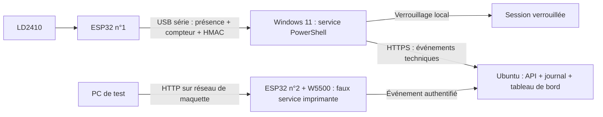

# Lorenzo — plan de travail CyberSentinel
> **Décision du 20 novembre 2026 :** refonte du projet E6. La gestion des mises à jour et le déploiement de logiciels sont **retirés**. Deux fonctions complémentaires sont retenues : prévention par radar et détection par leurre réseau. Ce document remplace les anciens plans « Poste attentif » (conservés dans l’historique Git).

## 1. Cap fixé

**Nom provisoire :** CyberSentinel — sécurisation d'une session Windows et détection d'interactions avec un leurre réseau embarqué.

**Problématique :** dans quelle mesure un démonstrateur ESP32 peut-il réduire le délai d’exposition d'une session laissée ouverte et fournir un signal d’alerte supplémentaire lors d’un accès à un faux service interne ?

**Pourquoi proposer cela à un service DGFiP :**
- le tuteur a confirmé des oublis de verrouillage de session (fait interne, ne pas publier avec des noms) ;
- l'ANSSI a publié le 29/09/2026 un rapport sur des cyberattaques touchant la DGFiP et des lacunes de détection / corrélation : [source ANSSI](https://cyber.gouv.fr/actualites/lanssi-publie-le-rapport-dincident-sur-les-cyberattaques-ayant-touche-la-dgfip/) ;
- les deux dispositifs sont complémentaires aux protections existantes ; **aucune affirmation** selon laquelle un leurre aurait empêché les attaques de 2026.

**Lieu d'essai :** lycée, réseau isolé, machines fictives et autorisées ; aucune installation dans le SI DGFiP.

## 2. Architecture retenue

**Indépendance impérative :** une panne d’Ubuntu ne doit pas empêcher le verrouillage local. Le radar ne pilote **pas** la détection sur le leurre ; une interaction réseau ne doit pas servir à déverrouiller ni verrouiller un poste.

**Périphérique leurre :** le W5500 fournit l’Ethernet à l’ESP32 ; le service HTTP factice affiche une page minimale **sans collecte d’identifiants ni fichiers**. La preuve de concept ne « détecte » que les connexions dirigées vers ce service.

## 3. Périmètre et livrables

### V1 : prototype minimal fonctionnel
- [ ] LD2410 + ESP32 n°1, UART, réglage des zones et des seuils
- [ ] Message de présence transmis au PC Windows de test et verrouillage local
- [ ] ESP32 n°2 + W5500, IP sur LAN isolé, service HTTP factice
- [ ] Enregistrement local d’un accès au leurre (date, IP source, chemin demandé)
- [ ] API Ubuntu de réception et tableau de bord minimal
- [ ] Captures Wireshark et démonstration de deux scénarios indépendants

### V2 : robustesse et évaluation
- [ ] HMAC-SHA256 + compteur pour les messages du radar ; rejet des relectures et faux boîtiers
- [ ] Authentification et chiffrement des flux vers l'API Ubuntu ; horodatage cohérent (NTP)
- [ ] File d’attente et reprise d’envoi après perte de réseau, sans perte du verrouillage local
- [ ] Politique de qualification des événements du leurre (scan d'inventaire autorisé = faux positif potentiel)
- [ ] Mesurer délais, erreurs, disponibilité et établir des résultats avec incertitudes
- [ ] Limitation des journaux à la finalité sécurité, rétention courte et absence de suivi nominatif de présence

### Extensions facultatives (uniquement après V1 et V2)
- [ ] Deuxième leurre avec autre protocole **basse interaction** (pas de serveur vulnérable)
- [ ] Tests de résistance à des événements répétitifs ; limitation de débit des remontées
- [ ] Mise en boîtier / documentation de reproductibilité

## 4. Tests de recette à exécuter

| ID | Scénario | Résultat attendu |
|---|---|---|
| T01 | Martine part | Session Windows verrouillée après délai défini |
| T02 | Martine lit sans toucher le clavier | Pas de faux verrouillage |
| T03 | Collègue passe dans la zone extérieure | Pas de maintien abusif si la zone est réglable |
| T04 | Message de boîtier falsifié ou rejoué | Refus et repli sur verrouillage d'inactivité Windows |
| T05 | Ubuntu est indisponible | Verrouillage local toujours fonctionnel |
| T06 | PC de laboratoire envoie `GET /` au leurre | Événement technique reçu et affiché |
| T07 | PC envoie `GET /admin` au leurre | Événement à qualifier, **pas preuve automatique d'attaque** |
| T08 | Inventaire réseau autorisé | Événement classable comme bénin, taux de faux positifs mesuré |
| T09 | Câble Ethernet du leurre débranché | Signalement de l'indisponibilité si supervision prévue |
| T10 | API Ubuntu momentanément coupée | Événements mis en attente et rejoués dans la limite prévue |

**Indicateurs :** latence départ→verrouillage ; faux verrouillages / nombre d’essais ; requêtes observées / requêtes envoyées ; latence requête→alerte ; fausses alertes de scans autorisés ; événements perdus après panne. Toutes les valeurs restent à mesurer.

## 5. Répartition prévisionnelle des ~150 h (à faire valider)

| Travail | Heures estimées |
|---|---:|
| Analyse du besoin, état de l’art, critères | 12 |
| Montage et étalonnage radar | 18 |
| Service Windows et logique de verrouillage | 22 |
| Leurre HTTP ESP32 + W5500 | 27 |
| API Ubuntu, stockage, tableau de bord | 24 |
| Authentification, repli et durcissement | 12 |
| Mesures, protocoles d’essais, physique | 22 |
| Documentation, soutenance, recette | 13 |
| **Total prévisionnel** | **150** |

## 6. Décisions ouvertes et risques

- [ ] Confirmer avec le collègue de physique la faisabilité et l’évaluation des mesures R1–R4
- [ ] Vérifier modèle de carte ESP32, câblage et pile réseau W5500
- [ ] Vérifier autorisation USB série sur Windows de laboratoire, ou employer un PC de test dédié
- [ ] Vérifier l’accès aux fonctions de verrouillage pour le compte/service Windows retenu
- [ ] Préciser l'architecture réseau du labo et les éventuelles politiques de filtrage
- [ ] Appliquer le principe de minimisation des données : aucun historique nominatif de présence
- [ ] Faire valider les modalités de réalisation du projet au lycée par les responsables académiques

## 7. Liens vers les fichiers du projet

- [Maquette Three.js interactive](livrables/animation-3d/maquette-3d.html) — refonte du 20/11/2026, **animation simulée**, 12 étapes
- [Présentation HTML interactive](livrables/page-html/poste-attentif.html) — nouvelle version CyberSentinel
- [Compte rendu historique du tuteur](entretien-tuteur-2026-11-16.md) — élément de contexte à conserver, même si le périmètre change
- [Cahier des charges](projet-cybersentinel.md)

## 8. Fichiers historiques qui demandent encore une refonte
- [ ] `fiche-academique/Fiche_presentation_E6_Lorenzo.docx` et `.pdf` : **ancienne version** ; ne pas envoyer sans réécriture
- [ ] `livrables/powerpoint-3b1b/Projet_E6_Lorenzo_3b1b.pptx` et son générateur : **ancienne version** ; ne pas utiliser comme nouvelle soutenance
- [ ] Toute archive ou capture d'écran montrant l'installation de mises à jour comme objectif du projet : **historique**, à régénérer
- [ ] Mettre à jour les questions du jury (PDF) et les schémas liés au formulaire
- [ ] Relire et tester les pages HTML dans un navigateur : **la validité syntaxique du JavaScript ne garantit pas le rendu WebGL**
