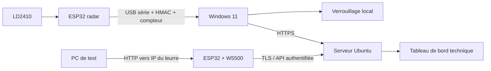

# CyberSentinel — cahier des charges de Lorenzo (version de travail)
**BTS CIEL, épreuve E6 · 20 novembre 2026**

> Proposition de preuve de concept destinée à être discutée avec le service. Aucune solution installée ou validée sur le réseau de la DGFiP. Le caractère innovant tient à la réalisation embarquée mesurée et à son insertion dans une défense en profondeur, non à l'invention du radar ou du honeypot.

## 1. Contexte et justification

La DGFiP gère des informations sensibles. La réduction des accès non autorisés et l'amélioration des signaux de détection sont deux objectifs de cybersécurité pertinents :
1. **Sécurité physique du poste** : un agent peut oublier de verrouiller Windows lorsqu’il quitte son bureau ; le tuteur de Lorenzo a rapporté ce problème lors de l’entretien du 16 novembre 2026.
2. **Détection réseau** : le [rapport d'incident ANSSI publié le 29 septembre 2026](https://cyber.gouv.fr/actualites/lanssi-publie-le-rapport-dincident-sur-les-cyberattaques-ayant-touche-la-dgfip/) constate des manques de détection et de corrélation dans les incidents analysés. Il **ne préconise pas spécifiquement** le leurre ESP32 décrit ici.

Lorenzo propose un **prototype expérimental**, susceptible d'être présenté au service informatique. Il ne remplace ni le SOC, ni l'EDR, ni les stratégies Windows, ni les équipements de défense déjà déployés.

## 2. Problématique et objectifs

**Question :** un dispositif embarqué accessible peut-il réduire l'exposition d'une session oubliée et produire un événement de détection supplémentaire lors de l'accès à un service leurre ?

**Objectif A — prévention :** raccourcir le délai de verrouillage sans provoquer trop de faux verrouillages. **Objectif B — détection :** observer et qualifier les accès à un faux service réseau, sans confondre un événement avec une intrusion démontrée. **Objectif C — exploitation :** disposer d'une supervision technique locale, horodatée et reproductible.

## 3. Description fonctionnelle

| Sous-système | Entrée | Traitement | Sortie |
|---|---|---|---|
| Radar LD2410 + ESP32-1 | Mouvement / micro-mouvement radar | Zone et temporisation ; trames avec compteur/HMAC | Présence ou absence authentifiée |
| Poste Windows 11 de test | Trames USB série | Vérification du HMAC, application des seuils et repli local | Verrouillage de session + événement technique |
| ESP32-2 + W5500 | Connexions HTTP à une adresse factice du labo | Service HTTP à basse interaction, journal minimal | Événement technique réseau |
| Ubuntu | Événements Windows et leurre | API sécurisée, horodatage, stockage, filtrage explicable | Vue de supervision et alertes à qualifier |

**Règle de sécurité :** le contrôle du verrouillage n'attend pas la réponse d'Ubuntu. Les deux sous-systèmes n'utilisent pas la présence physique pour « attribuer » une attaque à un utilisateur. L'absence n'est pas une identité.

### Architecture

### Réseau de démonstration (exemples, à configurer)

- PC Windows : `10.10.0.54`
- PC de test : `10.10.0.73`
- Leurre HTTP : `10.10.0.80:80`
- Serveur Ubuntu : `10.10.0.20`

Ces adresses sont des exemples pour la maquette 3D, **pas des adresses de la DGFiP**. Les échanges de supervision seront authentifiés et, dès qu'ils transitent sur IP, chiffrés lorsque c'est adapté.

## 4. Matériel et logiciels envisagés

- 2 × ESP32 (modèles à confirmer) ; 1 × radar LD2410 (24 GHz) ; 1 × interface Ethernet W5500 ; LED et alimentation 5 V protégée.
- 1 PC Windows 11 de test ; 1 serveur Ubuntu (physique ou machine virtuelle) ; 1 PC de test HTTP ; switch ; câbles.
- PowerShell pour le programme Windows ; programme embarqué ESP32 ; Python pour l'API et le tableau de bord ; SQLite pour les journaux ; Wireshark pour les captures.

**Pas de second capteur de distance, de caméra ou de capteur ajouté artificiellement.** Le second ESP32 est un équipement réseau autonome, non un capteur supplémentaire du radar.

## 5. Déroulé de démonstration

1. Martine consulte un document, reste immobile : le radar doit maintenir l'état « présente ».
2. Elle quitte le bureau ; après temporisation, Windows se verrouille sans attendre le réseau.
3. Un poste de laboratoire interroge `http://10.10.0.80/` puis un chemin fictif `/admin`.
4. Le leurre reçoit la requête, remonte IP, horodatage et chemin au serveur Ubuntu.
5. Le technicien voit deux événements distincts. L'accès au leurre est **signalé et à qualifier**, sans attribution à Martine.
6. Une panne du serveur est simulée : le verrouillage fonctionne encore, les flux réseau sont rétablis selon la politique de reprise.

## 6. Essais et critères de réussite

Mesurer la latence de verrouillage, le taux de faux verrouillages, la couverture des requêtes HTTP de test, la latence d'alerte, le taux de faux positifs avec inventaire autorisé, le comportement réseau en panne et l'acceptation/rejet des messages HMAC.

Les seuils de réussite seront définis avant les expériences ; **aucune performance chiffrée n'est encore démontrée**. L'expression « détection d'intrusion » est remplacée par « détection d'interactions avec un leurre » tant qu'une évaluation expérimentale ne justifie pas davantage.

## 7. Limites, conformité, protection des données

- Usage sur un LAN isolé de laboratoire ; pas de déploiement DGFiP ni de scan du réseau d'entreprise sans autorisation.
- Le leurre ne contient aucune donnée fiscale, aucun mot de passe, aucune vraie application vulnérable.
- Journaux limités au strict nécessaire ; pas de suivi nominatif des présences ni des durées d'absence.
- Une interaction avec un leurre peut provenir d'un scanner légitime ; elle n'est pas une preuve de malveillance.
- Tester la compatibilité et les droits nécessaires avant toute installation réelle ; faire valider l'éventuelle expérimentation par les responsables sécurité et protection des données.

## 8. Références

- ANSSI, *L’ANSSI publie le rapport d’incident sur les cyberattaques ayant touché la DGFiP*, 29 septembre 2026 : https://cyber.gouv.fr/actualites/lanssi-publie-le-rapport-dincident-sur-les-cyberattaques-ayant-touche-la-dgfip/
- ANSSI, *Guide d'hygiène informatique* : https://messervices.cyber.gouv.fr/guides/guide-dhygiene-informatique
- CNIL, *Sécurité : tracer les opérations* : https://www.cnil.fr/fr/securite-tracer-les-operations

## 9. Suivi des décisions et prochaines actions

Voir [TODO.md](TODO.md), les [animations Three.js](livrables/animation-3d/maquette-3d.html) et la [présentation interactive](livrables/page-html/poste-attentif.html).

**Attention :** les anciens DOCX, PDF et PowerPoint n'ont pas encore été réécrits pour cette nouvelle version. Ils ne doivent pas être utilisés comme documents définitifs.
